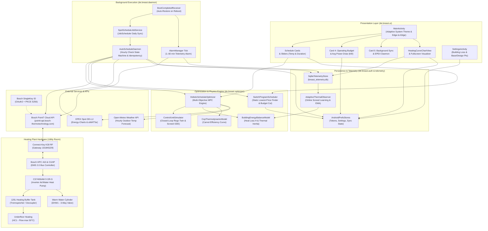
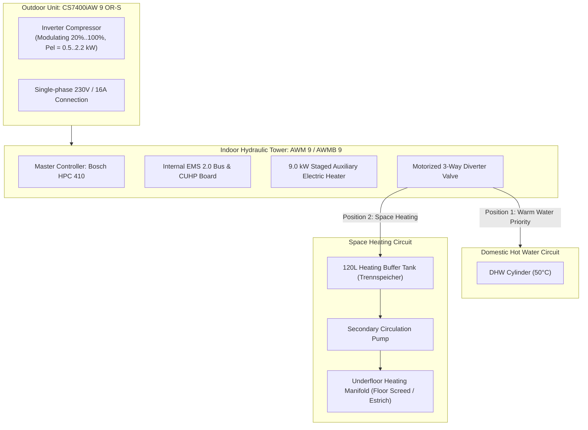

# BREAST System Architecture Documentation

*Languages / Sprachen / 语言: **English** | [Deutsch](ARCHITECTURE_DE.md) | [中文](ARCHITECTURE_ZH.md)*

This document describes the software architecture, data flow, background scheduling mechanisms, and physical heating plant integration of the **BREAST** (*Bosch Reverse Engineering API SingleKey Test*) application.

---

## 1. High-Level Architecture Diagram

---

## 2. Component Breakdown

### 2.1 Presentation Layer (`de.breast.ui`)
* **`MainActivity.kt`**:
  * Programmatic Android View architecture styled with an adaptive `UiPalette` supporting **Light & Dark modes** and **Android 15 Edge-to-Edge** with `WindowInsetsCompat.Type.ime()` automatic scroll adjustment.
  * **Card 1 (Hero Header)**: SingleKey ID connection status, live setpoint, and last sync timestamp.
  * **Card 2 (Target Comfort & Runtime)**:
    * `SeekBar` for Target Comfort Temperature (`15.0°C .. 30.0°C`, step `0.5°C`).
    * `SeekBar` for Target Daily Runtime (`0.5 h .. 16.0 h`, step `0.5 h`).
  * **Card 3 (Schedule Visualizer)**: Live Today & Tomorrow schedule cards displaying active heating windows, average spot price, estimated daily cost in EUR, and translated switch points. Features a 3-tap override protection barrier if external thermostat tweaks are detected.
  * **Card 4 (Operating Budget & Heat Pump Power)**:
    * Hard daily budget cap input field (€/day).
    * Dynamic power model / power draw input field (kW) supporting automatic inverter modulation (`Auto (~0.6kW)`) and manual fixed power override.
    * Instant text watchers committing inputs immediately to persistent preferences.
  * **Card 5 (Background Automation & EPEX Spot Sync)**: Hourly daemon toggle, sync status badge, battery optimization shortcut, and full 7-day schedule inspector.
  * **Card 6 (Heating Curve & Telemetry View)**: Interactive non-linear supply curve with live sensor badges.
  * **Card 7 (Developer / Debug Console)**: Collapsible diagnostic terminal, telemetry toggle, recording frequency slider (`1 min .. 60 min`), and database management.
* **`HeatingCurveChartView.kt` & `HeatingCurveFullscreenActivity.kt`**:
  * Renders the manufacturer's non-linear supply water curve:
    $$T_{\text{supply}} = T_{\text{base}} + \frac{T_{\text{design}} - T_{\text{base}}}{(-10 - 20)^\alpha} \cdot (T_{\text{outdoor}} - 20)^\alpha + \Delta T_{\text{parallel}}$$
  * Interactive fullscreen view supporting reference curves [1–5], steady-state and transient scatter points, live crosshair marker, and persistent chip selections synchronized with the dashboard.
* **`SettingsActivity.kt`**:
  * Calibration interface for building heat loss coefficient ($H$ in kW/K), maximum thermal buffering ($\Delta T_{\text{max}}$), heating curve base/design temperatures, and weather location.

---

### 2.2 Optimization Engine (`de.breast.optimizer`)

> [!NOTE]
> For the complete mathematical and physical rationale governing the equilibrium zero-line anchor ($\Delta t = 0$), net arbitrage inequality, concrete screed phase lag, and German dynamic tariff breakdown, see the dedicated specification: [HEAT_PUMP_OPTIMIZATION_PLAN.md](HEAT_PUMP_OPTIMIZATION_PLAN.md).

#### A. Holistic Schedule Optimizer (`HolisticScheduleOptimizer.kt`)
* Implements a **Model Predictive Control (MPC)** solver evaluating candidate continuous operating windows against a multi-objective cost function:
  $$J = w_{\text{budget}} \cdot J_{\text{budget}} + w_{\text{cop}} \cdot J_{\text{cop}} + w_{\text{comfort}} \cdot J_{\text{comfort}}$$
* **Objectives:**
  1. **Budget Utility ($J_{\text{budget}}$):** Formulated as average electricity cost per kWh ($\bar{c}_{\text{gross}}$) plus peak arbitrage penalty and an explicit runtime deficit penalty:
     $$\text{Penalty}_{\text{deficit}} = 2.5 \cdot (\max(0, t_{\text{target}} - t_{\text{dur}}))^{1.6}$$
     Guiding the solver to find the cheapest hours for the requested duration rather than greedily cutting runtime.
  2. **COP Utility ($J_{\text{cop}}$):** Normalized thermodynamic efficiency favoring warmer outdoor periods.
  3. **Comfort Utility ($J_{\text{comfort}}$):** Penalizes indoor temperature deviations from setpoint based on simulated building heat loss.
* **4 Optimization Preferences & Proportional Expansion Corridors:**
  * **Non-Negative Runtime Corridors ($+0.0\text{ h}$ Firm Floor):** Anchored to user slider target across all modes, eliminating unwanted shrinkage or mild-weather collapse.
  * **Harmonized Quantizer:** Discrete steps of $Q = 0.5\text{ h}$ ($30\text{ min}$) align continuous expansion $\Delta H = \operatorname{round}\left(\frac{T_{\text{set}} \cdot r}{Q}\right) \cdot Q$ with user controls and 15-minute grid slots.
  * **Comfort Priority:** $w = [0.15, 0.25, 0.60]$, expansion $r = +20\%$, corridor $[0.0\text{h}, \text{quantize}(0.20 \cdot T_{\text{set}})]$. Minimizes indoor temperature variance and screed cooling during occupancy.
  * **Balanced (Recommended):** $w = [0.35, 0.35, 0.30]$, expansion $r = +25\%$, corridor $[0.0\text{h}, \text{quantize}(0.25 \cdot T_{\text{set}})]$. Harmonious trade-off between spot price, thermodynamic COP lift, and comfort, expanding into cheap midday solar hours.
  * **Efficiency (COP / Bang for Buck) Priority:** $w = [0.15, 0.35, 0.50]$, expansion $r = +35\%$, corridor $[0.0\text{h}, \text{quantize}(0.35 \cdot T_{\text{set}})]$. Maximizes delivered thermal heat per euro ($\frac{\text{COP}}{c_{\text{gross}}}$) with an active daytime bonus encouraging running longer at low modulation ($25\%\text{–}35\%$) across solar noon hours ($10:00\text{–}16:30$) within budget.
  * **Budget Priority:** $w = [0.70, 0.15, 0.15]$, expansion $r = +0\%$. **Strict Nominal Runtime Lock** ($[0.0\text{h}, 0.0\text{h}]$ relative to target runtime slider). Evaluates the single cheapest continuous spot price window of that exact duration without voluntary stretching or shrinking.
* **Double-Tracked 24h Total Metrics:** Explicitly separates active heating window energy and cost from full 24h day totals, incorporating continuous secondary underfloor circulation pump and electronics draw ($50\text{ W}$ parasitic baseline) across idle periods.
* **Thermodynamic Audit Section 5:** Exposes live dynamic corridor parameters, expansion ratio, quantizer step size, candidate slot evaluation bounds, and selected duration delta in the audit modal.
* **Two-Stage Budget Evaluation & Marginal Cost Edge Shaving:**
  * **Stage 1 (Corridor Evaluation):** Evaluates candidate windows strictly within the duration corridor. If any candidate fits within `dailyBudgetEuro`, the best candidate is selected and `budgetCutMinutes = 0` (zero false budget-cut notifications).
  * **Stage 2 (Marginal Cost Edge Shaving):** If and only if every window in the target corridor breaches `dailyBudgetEuro`, the optimizer takes the cheapest corridor candidate and iteratively trims 15-minute slots from whichever boundary has a higher marginal cost per delivered thermal unit:
    $$c_{\text{heat}}(t) = \frac{c_{\text{gross}}(t)}{\text{COP}(t)}$$
    Slots are shaved from the start edge ($S$) if $c_{\text{heat}}(S) \ge c_{\text{heat}}(E-1)$, or the end edge ($E-1$) otherwise, until total estimated cost $\le \text{dailyBudgetEuro}$ (or until reaching the 90-minute minimum compressor runtime). Sets `isBudgetForcedCut = true` and accurately reports `budgetCutMinutes`.

#### B. Physical Models & Digital Twin
* **`ControlUnitSimulator.kt`**:
  * Closed-loop digital twin simulating the exact state machine of the Bosch HPC 410 / Rego control unit.
  * Evaluates return water temperature tracking against target supply curve, with cut-in hysteresis ($-1.2\text{ K}$) and cut-out ($+0.5\text{ K}$).
  * Concrete floor screed thermal differential ODE:
    $$C_s \frac{dT_s}{dt} = \dot{Q}_{\text{in}} - \dot{Q}_{\text{floor}}$$
  * Accounts for standby electrical draw (15 W idle power).
* **`BuildingEnergyBalanceModel.kt`**:
  * 3-state building thermal inertia model calculating building heat loss rate:
    $$Q_{\text{loss}}(t) = H \cdot (T_{\text{in}}(t) - T_{\text{outdoor}}(t))$$
  * Simulates floor screed and 120L buffer tank thermal storage and cooling rates during setback hours.
* **`CopThermodynamicModel.kt`**:
  * Models heat pump Carnot COP scaling with temperature lift:
    $$\text{COP}(t) = \eta_C \cdot \frac{T_{\text{supply}}(t) + 273.15}{T_{\text{supply}}(t) - T_{\text{outdoor}}(t)}$$
    where $\eta_C \approx 0.45 - 0.52$.
* **Empirical Ground-Truth COP Interpolation & Inverter Dynamics**:
  * Replaces flat static power assumptions with an empirical thermodynamic regression calibrated against month-to-date hardware telemetry ($448\text{ kWh}_{\text{th}}$ delivered vs $64\text{ kWh}_{\text{el}}$ compressor power, average COP $7.00$):
    $$\text{COP}(\Delta T_{\text{lift}}) = \frac{1}{0.0068 \cdot (T_{\text{supply}} - T_{\text{outdoor}}) + 0.0062}$$
    Unifying mild autumn weather ($\text{COP} \approx 8.70$ at $16\text{ K}$ lift) and deep January winter ($\text{COP} = 4.09$ at $35\text{ K}$ lift).
  * Models the physical compressor inverter minimum floor at **`28.0%`** ($\approx 25\text{ Hz}$), outputting $\dot{Q}_{\text{min}} \approx 3.0\text{ kW}_{\text{th}}$ at $P_{\text{el}} \approx 0.35\text{ kW}$ in mild weather.
  * Dynamically computes compressor electrical draw and adds the continuous parasitic baseline ($P_{\text{parasitic}} = 50\text{ W}$ continuous, ~$1.20\text{ kWh/day}$) covering the secondary underfloor pump and electronics, with dedicated external submeter calibration support.

#### C. Static Scheduler (`SwitchProgramScheduler.kt`)
* Discretizes the 24-hour day into 15-minute `RasterSlot` segments aligned with EPEX Spot Day-Ahead tariffs.
* Finds the exact contiguous window minimizing total euro cost for the user's slider runtime.
* Enforces hard budget caps by trimming slots down to minimum continuous run blocks (90 min).
* Safely grounds the 23:45 boundary slot so ON states never bleed across midnight.

---

### 2.3 Telemetry & Thermal Analytics Engine (`de.breast.telemetry`)
* **`HeatPumpTelemetrySnapshot.kt`**: Immutable snapshot capturing outdoor temperature, flow supply, return, condenser temperature, delta $T$, modulation %, demand mode (`ch`, `dhw`, `idle`), and hourly spot electricity price.
* **`SqliteTelemetryStore.kt`**: Native SQLite time-series database (`breast_telemetry.db`) using `SQLiteOpenHelper`. Indexed on `epoch_seconds` for fast range queries and instant CSV exports.
* **`HeatingCurveAnalyzer.kt`**:
  * Evaluates operating points against Bosch underfloor specifications and measures thermal decay rate ($\Delta T_{\text{return}} / \Delta t$) during off hours.
  * **Target Temperature Consistency Filter**: Filters out telemetry rows where the target temperature was modified or transient, ensuring pure equilibrium heating curve analysis.
  * Routes nocturnal cooling calculations directly through `SetbackHeatLossEstimator` with strict astronomical filtering.
* **`SetbackHeatLossEstimator.kt`**:
  * **NOAA Astronomical Solar Position Model**: Isolates pure nocturnal periods by calculating exact solar sunset and sunrise for the user's geographic coordinates; enforces that data collection begins strictly $\ge 2\text{ hours}$ after sunset to eliminate solar insolation and wall thermal lag. Seamlessly bridges nocturnal blocks across calendar midnight (e.g. 19:00 to 04:15 next morning).
  * **Strict Operating Setback Verification**: Enforces that the heat pump is genuinely in setback mode ($T_{\text{setpoint}} \le 18.5^\circ\text{C}$ or $T_{\text{setpoint}} \le T_{\text{comfort}} - 2.0\text{ K}$, compressor OFF, modulation $0\%$, heating and DHW idle, hydraulic loop equalized $\le 1.5\text{ K}$). Immediately truncates when comfort heating engages (e.g. at 04:15 CET).
  * **Model 3: 2R2C State-Space Dynamic Capacitance Observer**: Differentiates between active floor screed buffer discharge and whole-building equilibrium decay:
    $$\alpha = \left(1.0 - \frac{\max(0.0, T_{\text{return, avg}} - T_{\text{comfort}})}{\Delta T_{\text{charge}}}\right).coerceIn(0.0, 1.0)$$
    $$C_{\text{eff}} = C_{\text{screed}} + \alpha \cdot C_{\text{indoor}}$$
    When the floor is warm ($T_{\text{return}} \ge T_{\text{comfort}} + 1.0\text{ K}$), $C_{\text{eff}} = C_{\text{screed}} = 4.8\text{ kWh/K}$. When the house has cooled to room temperature ($T_{\text{return}} \le T_{\text{comfort}}$), the entire building envelope decays together, giving $C_{\text{eff}} = C_{\text{screed}} + C_{\text{indoor}} = 13.3\text{ kWh/K}$.
  * **Multi-Point Least-Squares Linear Regression**: Fits continuous cooling slope and coefficient of determination $R^2$ across all $N$ block samples ($R^2 \ge 0.70$, cooling rate $\ge 0.04\text{ K/h}$).
  * **Multi-Night $R^2 \times \text{Duration}$ Weighted Regression**: Combines valid nocturnal cooldown windows across multiple nights into an aggregate building heat loss coefficient ($W/K$), rendered with user-friendly local CET timestamps.
* **`AdaptiveThermalObserver.kt`**:
  * **Continuous Online Screed Learning**: Listens to live telemetry stream and tracks return temperature decay during nocturnal setback blocks ($\ge 2\text{ hours}$ post-sunset until morning restart).
  * **Exponential Moving Average (EMA) Parameter Adaptation**: Computes continuous cooling rate and updates the building heat loss coefficient $H_{\text{bld}}$ and decay constant $\kappa$ via exponential moving average ($\alpha_{\text{learn}} = 0.20$) whenever statistical fit confidence meets $R^2 \ge 0.65$.
  * **Closed-Loop Model Injection**: Injects live estimated screed return temperature directly into `BuildingEnergyBalanceModel` to continuously refine the thermal energy requirement prediction without manual calibration.
* **Parasitic Electrical Baseline & Submeter Calibration**:
  * Unmetered continuous loads (secondary underfloor heating pump ~25W, mainboards, CUHP and K30 gateway ~15W) are decoupled from compressor motor power.
  * Standardized generous baseline rule of thumb: $P_{\text{parasitic}} = 50\text{ W}$ continuous (~$1.2\text{ kWh/day}$).
  * Integrated dedicated calibration variable in `UserSettingsStore` and `HolisticOptimizationConfig` to ingest measured power from external physical submeters (e.g., Shelly 3EM, Eastron SDM).

---

### 2.4 Autonomous Daemon & Background Scheduling (`de.breast.daemon`)
* **`AutoScheduleDaemon.kt`**: State machine executing hourly price checks. Operates idempotently:
  * Computes signatures of current settings and applied schedules.
  * Avoids disturbing today's running schedule in the background once applied.
  * Automatically stages tomorrow's schedule once EPEX Day-Ahead prices release (12:00–15:00 CET).
  * Halts automatic overwrites if an external manual adjustment is detected on the heat pump.
* **`SpotScheduleJobService.kt`**: Android `JobScheduler` implementation for battery-efficient background execution.
* **`AlarmManager` High-Frequency Ticker**: Uses `AlarmManager.setAndAllowWhileIdle()` to collect telemetry at the user-defined frequency (`1 min .. 60 min`) through Android Doze mode.
* **`BootCompletedReceiver.kt`**: Restores background jobs and alarms upon device restart or package update.

---

### 2.5 API & Authentication Layer
* **`SingleKeyAuthManager.kt`**: Handles Bosch SingleKey ID OAuth2 with PKCE (`S256`), token storage, and automatic refresh token rotation.
* **`PointTApiClient.kt`**: REST client for Bosch PointT Cloud API (`pointt-api.bosch-thermotechnology.com`). Transmits modern naked top-level array switch program payloads with wrapped fallback.
* **`SpotPriceClient.kt`**: Fetches EPEX Spot `DE-LU` prices from Fraunhofer Energy-Charts and aWATTar APIs, applying German taxes, 19% VAT, and Vattenfall dynamic grid surcharges.
* **`WeatherForecastClient.kt`**: Queries Open-Meteo for hourly outdoor temperature forecasts used by the MPC building energy balance model.

---

## 3. Physical Heating Plant Integration

The software models and controls the following physical installation:

### Hydraulic Decoupling via the 120L Buffer
* During Domestic Hot Water heating, the 3-way valve diverts primary heat pump output away from the heating circuit. The secondary circulation pump draws heat from the 120L buffer into the underfloor heating without interruption.
* Combined with the thermal mass of the floor screed, the building maintains steady indoor comfort during DHW runs.
* **Unified Schedule Design:** Scheduling both CH and DHW to run during the cheapest spot hours maximizes electricity savings while keeping switch point transitions clean and minimal.
