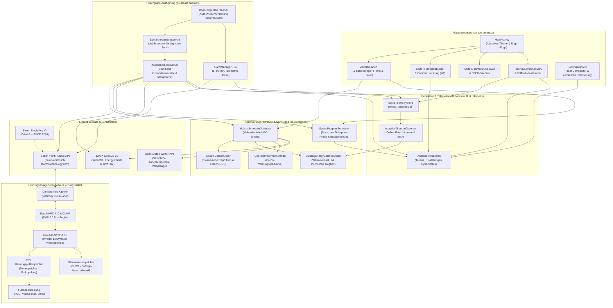
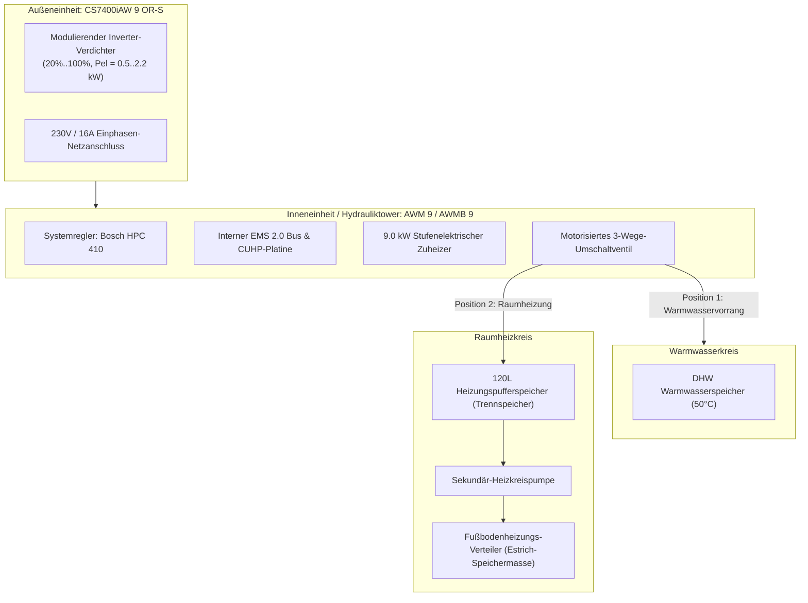

# BREAST Heatpump Systemarchitektur-Dokumentation

*Sprachen / Languages: [English](ARCHITECTURE.md) | **Deutsch** | [中文](ARCHITECTURE_ZH.md)*

Dieses Dokument beschreibt die Softwarearchitektur, den Datenfluss, die Hintergrund-Automatisierungsmechanismen und die physikalische Einbindung der Heizungsanlage in der Anwendung **BREAST Heatpump** (*Bosch Reverse Engineered API Smart Tool for Heatpump*).

---

## 1. Übergeordnetes Architekturdiagramm



---

## 2. Komponentenübersicht

### 2.1 Präsentationsschicht (`de.breast.ui`)
* **`MainActivity.kt`**:
  * Programmatische Android-View-Architektur mit adaptiver `UiPalette`, die **Hell- & Dunkelmodus** sowie **Android 15 Edge-to-Edge** mit dynamischer `WindowInsetsCompat.Type.ime()`-Tastaturanpassung unterstützt.
  * **Karte 1 (Status-Header)**: SingleKey ID Verbindungsstatus, aktuelle Solltemperatur und Zeitstempel der letzten Synchronisation.
  * **Karte 2 (Ziel-Komfort & Laufzeit)**:
    * `SeekBar` für die Ziel-Heiztemperatur (`15.0°C .. 30.0°C`, Schrittweite `0.5°C`).
    * `SeekBar` für die tägliche Ziel-Betriebsdauer (`0.5 h .. 16.0 h`, Schrittweite `0.5 h`).
  * **Karte 3 (Schaltzeit-Visualisierer)**: Live-Karten für den heutigen und morgigen Zeitplan mit aktiven Heizfenstern, durchschnittlichem Strompreis, geschätzten Tageskosten in EUR und übersetzten Schaltpunkten. Enthält eine 3-Tap-Sicherheitsbarriere gegen versehentliches Überschreiben externer Thermostat-Anpassungen.
  * **Karte 4 (Betriebsbudget & Wärmepumpenleistung)**:
    * Eingabefeld für das tägliche Maximalbudget (€/Tag).
    * Eingabefeld für das dynamische Leistungsmodell / elektrische Leistungsaufnahme (kW) mit automatischer Inverter-Modulation (`Auto (~0.6kW)`) oder fester manueller Vorgabe.
    * Sofortige TextWatcher-Aktualisierung direkt beim Tippen ohne Fokusverlust.
  * **Karte 5 (Hintergrund-Automatisierung & EPEX Spot Sync)**: Schalter für stündlichen Daemon, Status-Badge, Akku-Optimierungs-Verknüpfung und 7-Tage-Schaltprogramm-Inspektor.
  * **Karte 6 (Heizkurve & Telemetrie)**: Interaktive nichtlineare Vorlaufkurve mit Live-Sensorwerten.
  * **Karte 7 (Entwickler- / Diagnose-Konsole)**: Einklappbares Terminal, Telemetrie-Umschalter, Schieberegler für Aufzeichnungsfrequenz (`1 Min. .. 60 Min.`) und Datenbankverwaltung.
* **`HeatingCurveChartView.kt` & `HeatingCurveFullscreenActivity.kt`**:
  * Visualisiert die exakte mathematische Kennlinie der Buderus/Bosch-Steuerung:

    ```math
    T_{\text{Vorlauf}} = T_{\text{Basis}} + \frac{T_{\text{Auslegung}} - T_{\text{Basis}}}{(-10 - 20)^\alpha} \cdot (T_{\text{Außen}} - 20)^\alpha + \Delta T_{\text{Parallel}}
    ```

  * Interaktive Querformat-Vollbildansicht mit Referenzkurven [1–5], stationären und transienten Messpunkten, Fadenkreuz-Markierung des aktuellen Betriebspunkts und bidirektional synchronisierter Kurvenauswahl.
* **`SettingsActivity.kt`**:
  * **Stromtarif-Compositor & Multi-Tarif-Modelle**:
    * Dynamischer EPEX-Spot-Compositor: Manuelle Justierung von Netto-Arbeitspreis, Grundpreis und flexibler Mehrwertsteuer (`MwSt`) mit 1-Klick-Ländervorlagen (0%, 7%, 19%, 20%).
    * Präzise numerische Dezimaleingabefelder (`EditText`) für alle Parameter (mit nativer Unterstützung für deutsches Komma `,` und internationalen Dezimalpunkt `.`).
    * Hoch-/Niedertarif (HT/NT / ToU): Zweitarif-Modell mit separaten HT- und NT-Preisen, Nachtfenster-Fahrplan und Wochenend-NT-Umschaltung. Synthetisiert 15-Minuten-Slots für die MPC-Zielführung ohne externe Börsen-APIs.
    * Festpreis-Modus (`Festpreis`): Konstanter Tarif mit direkter Betragseingabe; MPC optimiert die Laufzeiten primär nach Carnot-COP-Effizienz und solaren Wärmegewinnen.
    * Echtzeit-Vertragsbrief-Vorschau: Zeigt die mathematische Berechnungsformel, Mindest-Bruttopreis (bei 0 ct Börsenpreis), Muster-Arbeitspreis (bei 5 ct Börse) und monatlichen Grundpreis.
  * **Empirische Modellkalibrierung & Telemetrie**:
    * Nachtabsenkungs-Analyse und Gebäude-Wärmeverlustberechnung mit 25.000-Punkte-Vergangenheitsanker.
    * Inverter-Modulations-PID-Kalibrierung mit 2x2 Kennzahlen-Chips und dynamischer Temperatur-Betriebskorridor-Projektionstabelle.
    * Optimierungs-Präferenzwahlschalter (Komfort, Ausgewogen, Effizienz, Budget).
    * Estrich-Pufferüberhöhungsschieber, ungemessene parasitäre Dauerlast (50 W) und externe Zähleranbindung.
  * **Android 15 Edge-to-Edge Theme & Systemarchitektur**:
    * Eigenes `@style/Theme.BreastApp` Theme basierend auf `@android:style/Theme.DeviceDefault.DayNight` mit `windowNoTitle=true` und `windowActionBar=false`.
    * Insets-Verarbeitung via `WindowInsetsCompat.Type.systemBars() or WindowInsetsCompat.Type.displayCutout()` garantiert sauberen Abstand unter Statusleiste und Kamera-Punch-Hole.
    * Einheitliche Navigation mit einer einzelnen `⚙ Einstellungen`-Schaltfläche in der Kopfzeile (redundanter Hero-Card-Button entfernt).
    * Horizontal scrollbare Kennzahlen-Badge-Leisten (`HorizontalScrollView`) mit einzeiliger vertikaler Zentrierung (`Gravity.CENTER_VERTICAL`) verhindern Stauchungen und Zeilenumbrüche.

---

### 2.2 Optimierungs-Engine (`de.breast.optimizer`)

> [!NOTE]
> Die vollständige mathematische und thermodynamische Herleitung des Gleichgewichts-Nullpunkt-Ankers ($\Delta t = 0$), der Netto-Arbitrage-Ungleichung, der Estrich-Phasenverschiebung und der deutschen Stromtarifstruktur ist in der Spezifikation [HEAT_PUMP_OPTIMIZATION_PLAN.md](HEAT_PUMP_OPTIMIZATION_PLAN.md) dokumentiert.

#### A. Ganzheitlicher Zeitplan-Optimierer (`HolisticScheduleOptimizer.kt`)
* Implementiert einen **Modellprädiktiven Regler (MPC - Model Predictive Control)**, der kontinuierliche Betriebszeitfenster anhand einer mehrkriteriellen Zielfunktion bewertet:

  ```math
  J = w_{\text{budget}} \cdot J_{\text{budget}} + w_{\text{cop}} \cdot J_{\text{cop}} + w_{\text{comfort}} \cdot J_{\text{comfort}}
  ```

* **Teilziele:**
  1. **Budget-Nutzen ($``J_{\text{budget}}``$):** Formuliert als durchschnittlicher Strompreis pro kWh ($``\bar{c}_{\text{brutto}}``$) zzgl. Spitzenpreis-Arbitrage-Strafe und einer expliziten Laufzeitdefizit-Strafe:

     ```math
     \text{Strafe}_{\text{Defizit}} = 2.5 \cdot (\max(0, t_{\text{Ziel}} - t_{\text{Dauer}}))^{1.6}
     ```

     Dadurch sucht der Optimierer die günstigsten Stunden für die gewünschte Laufzeit, anstatt die Heizdauer gierig auf Null zu kürzen.
  2. **COP-Nutzen ($``J_{\text{cop}}``$):** Normierter thermodynamischer Wirkungsgrad, der wärmere Nachmittagsstunden bevorzugt.
  3. **Komfort-Nutzen ($``J_{\text{comfort}}``$):** Bestraft Abweichungen der Raumtemperatur vom Sollwert basierend auf dem simulierten Gebäude-Wärmeverlust.
* **4 Optimierungs-Präferenzen & Proportionale Expansionskorridore:**
  * **Nicht-negative Laufzeitkorridore ($+0.0\text{ h}$ feste Untergrenze):** Über alle Modi hinweg strikt an der Zielvorgabe des Schiebereglers verankert; verhindert unerwünschte Stauchung oder Laufzeiteinbrüche bei milder Witterung.
  * **Harmonisierte Quantisierung (Harmonized Quantizer):** Diskrete Schrittweite $Q = 0.5\text{ h}$ ($30\text{ Min.}$) synchronisiert stetige Expansionen $``\Delta H = \text{round}\left(\frac{T_{\text{Ziel}} \cdot r}{Q}\right) \cdot Q``$ mit den Regler-Schritten und den 15-Minuten-Raster-Slots.
  * **Komfort-Priorität:** $w = [0.15, 0.25, 0.60]$, Expansionsrate $r = +20\%$, Korridor $``[0.0\text{h}, \text{quantize}(0.20 \cdot T_{\text{Ziel}})]``$. Minimiert Raumtemperaturschwankungen und verhindert Auskühlen des Estrichs während der Nutzungszeiten.
  * **Ausgewogen (Empfohlen):** $w = [0.35, 0.35, 0.30]$, Expansionsrate $r = +25\%$, Korridor $``[0.0\text{h}, \text{quantize}(0.25 \cdot T_{\text{Ziel}})]``$. Harmonische Balance zwischen Börsenstrompreis, thermodynamischem COP-Hub und Wohnkomfort mit maßvoller Ausdehnung in günstige Sonnenstunden.
  * **Effizienz-Priorität (COP / Bang for Buck):** $w = [0.15, 0.35, 0.50]$, Expansionsrate $r = +35\%$, Korridor $``[0.0\text{h}, \text{quantize}(0.35 \cdot T_{\text{Ziel}})]``$. Maximiert die abgegebene Nutzwärme pro Euro ($``\frac{\text{COP}}{c_{\text{brutto}}}``$) mit aktivem Laufzeit-Bonus für langes Fahren bei niedriger Inverter-Modulation ($25\%\text{–}35\%$) über die sonnenreichen Mittagsstunden ($10:00\text{–}16:30$) innerhalb des Budgets.
  * **Budget-Priorität:** $w = [0.70, 0.15, 0.15]$, Expansionsrate $r = +0\%$. **Strikte nominale Laufzeitbindung** ($[0.0\text{h}, 0.0\text{h}]$ relativ zum Ziel-Laufzeit-Schieberegler). Wählt das absolut günstigste zusammenhängende Spot-Fenster exakt dieser Dauer ohne freiwillige Dehnung oder Stauchung.
* **Doppelspurige 24h-Gesamtmetriken:** Trennt den aktiven Heizfenster-Verbrauch und dessen Kosten sauber vom 24-Stunden-Gesamttag unter Berücksichtigung der kontinuierlichen parasitären Grundlast ($50\text{ W}$ Fußboden-Umwälzpumpe und Elektronik).
* **Abschnitt 5 im Thermodynamik-Audit-Modal:** Zeigt die dynamischen Korridor-Parameter, den Expansionsfaktor, die Quantisierungs-Schrittweite, Slot-Suchgrenzen und das gewählte Laufzeitdelta transparent an.
* **Zwei-Stufen-Budgetbewertung & Marginal-Cost-Kantenbeschneidung:**
  * **Stufe 1 (Korridor-Bewertung):** Bewertet Kandidatenfenster strikt innerhalb des definierten Laufzeitkorridors. Passt ein Kandidat ins Budget `dailyBudgetEuro`, wird der beste Kandidat ausgewählt und `budgetCutMinutes = 0` gesetzt (keine fälschlichen Kürzungsanzeigen).
  * **Stufe 2 (Marginal-Cost-Kantenbeschneidung):** Nur wenn ausnahmslos jedes Fenster im Zielkorridor `dailyBudgetEuro` überschreitet, nimmt der Optimierer den günstigsten Korridor-Kandidaten und trimmt iterativ 15-Minuten-Slots an der Kante mit den höheren spezifischen Wärmekosten ab:

    ```math
    c_{\text{Wärme}}(t) = \frac{c_{\text{brutto}}(t)}{\text{COP}(t)}
    ```

    Slots werden an der Startkante ($S$) gekürzt, wenn $``c_{\text{Wärme}}(S) \ge c_{\text{Wärme}}(E - 1)``$, andernfalls an der Endkante ($E - 1$), bis die geschätzten Kosten $\le \text{dailyBudgetEuro}$ sind (oder die Mindestlaufzeit von 90 Minuten erreicht ist). Setzt `isBudgetForcedCut = true` und meldet präzise `budgetCutMinutes`.

#### B. Physikalische Modelle & Digital Twin
* **`ControlUnitSimulator.kt`**:
  * Closed-Loop-Digital-Twin zur exakten Nachbildung der internen Zustandsmaschine des Bosch HPC 410 / Rego-Reglers.
  * Bildet die Rücklauftemperaturführung anhand der Soll-Vorlaufkurve mit Einschalthysterese ($-1.2\text{ K}$) und Ausschalthysterese ($+0.5\text{ K}$) ab.
  * Estrich-Wärmedifferenzialgleichung (ODE):

    ```math
    C_s \frac{dT_s}{dt} = \dot{Q}_{\text{in}} - \dot{Q}_{\text{Boden}}
    ```

  * Berücksichtigt den elektrischen Standby-Verbrauch (15 W Ruheleistung).
* **`BuildingEnergyBalanceModel.kt`**:
  * 3-Zustands-Wärmeträgheitsmodell des Gebäudes zur Berechnung der Auskühlrate:

    ```math
    Q_{\text{Verlust}}(t) = H \cdot (T_{\text{Innen}}(t) - T_{\text{Außen}}(t))
    ```

  * Simuliert die thermische Speicherfähigkeit des Estrichs und des 120L-Pufferspeichers während der Absenkzeiten.
* **`CopThermodynamicModel.kt`**:
  * Berechnet den theoretischen Carnot-COP in Abhängigkeit vom Temperaturhub:

    ```math
    \text{COP}(t) = \eta_C \cdot \frac{T_{\text{Vorlauf}}(t) + 273.15}{T_{\text{Vorlauf}}(t) - T_{\text{Außen}}(t)}
    ```

    wobei der Gütegrad $``\eta_C \approx 0.45 - 0.52``$ beträgt.
* **Empirische COP-Interpolation & Inverter-Dynamik**:
  * Ersetzt statische Leistungsannahmen durch eine empirische thermodynamische Regression, kalibriert an den realen Monatsdaten der Wärmepumpe ($``448\text{ kWh}_{\text{th}}``$ Wärmeabgabe bei $``64\text{ kWh}_{\text{el}}``$ Verdichterstrom, Monats-COP $7.00$):

    ```math
    \text{COP}(\Delta T_{\text{Hub}}) = \frac{1}{0.0068 \cdot (T_{\text{Vorlauf}} - T_{\text{Außen}}) + 0.0062}
    ```

    Verbindet milde Herbsttage ($\text{COP} \approx 8.70$ bei $16\text{ K}$ Hub) nahtlos mit tiefen Wintertagen ($\text{COP} = 4.09$ bei $35\text{ K}$ Hub).
  * Berücksichtigt die Hardware-Mindestmodulation des CS7400iAW von **`28.0%`** ($\approx 25\text{ Hz}$), was bei $12^\circ\text{C}$ einer Mindestheizleistung von $``\dot{Q}_{\text{min}} \approx 3.0\text{ kW}_{\text{th}}``$ und $``P_{\text{el}} \approx 0.35\text{ kW}``$ entspricht.
  * Berechnet die Verdichteraufnahme dynamisch und addiert die kontinuierliche parasitäre Dauerlast ($``P_{\text{parasitär}} = 50\text{ W}``$, ~ $1.20\text{ kWh/Tag}$) für die Fußboden-Pumpe und Elektronik, inklusive Schnittstelle für externe Submeter-Messungen.

#### C. Statischer Planer (`SwitchProgramScheduler.kt`)
* Teilt den Tag in 15-Minuten-Zeitschlitze (`RasterSlot`) passend zu den EPEX Spot Day-Ahead-Tarifen ein.
* Sucht das zusammenhängende Einzelfenster mit minimalen Stromkosten für die eingestellte Laufzeit.
* Setzt Budgetobergrenzen durch Kürzungs-Schritte bis zum Mindestlaufzeitblock (90 Min.) durch.
* Reserviert den Schaltpunkt um 23:45 Uhr als AUS, damit Betriebszeiten nicht unkontrolliert in den Folgetag übergehen.

---

### 2.3 Telemetrie- & Wärmeanalyse-Engine (`de.breast.telemetry`)
* **`HeatPumpTelemetrySnapshot.kt`**: Unveränderliches Datenmodell für Außen-, Vorlauf-, Rücklauf- und Kondensatortemperatur, $\Delta T$, Modulationsgrad (%), Wärmeanforderung (`ch`, `dhw`, `idle`) und stündlichen Strompreis.
* **`SqliteTelemetryStore.kt`**: SQLite-Zeitreihendatenbank (`breast_telemetry.db`) mit Index auf `epoch_seconds` für schnelle Bereichsabfragen und CSV-Export.
* **`HeatingCurveAnalyzer.kt`**:
  * Vergleicht Betriebspunkte mit Bosch-Fußbodenspezifikationen und ermittelt die Abkühlrate ($``\Delta T_{\text{Rücklauf}} / \Delta t``$) im Absenkbetrieb.
  * **Solltemperatur-Konsistenzfilter**: Filtert historische Telemetriezeilen heraus, bei denen die Zieltemperatur abweichend eingestellt oder transient war, um saubere Gleichgewichtskurven zu gewährleisten.
  * Leitet nächtliche Abkühlungsberechnungen direkt an `SetbackHeatLossEstimator` mit strikter astronomischer Filterung weiter.
* **`SetbackHeatLossEstimator.kt`**:
  * **NOAA-Astronomisches Sonnenstandsmodell**: Ermittelt genauen Sonnenuntergang und -aufgang nach NOAA-Gleichungen; erfordert strikt $\ge 2\text{ Stunden}$ nach Sonnenuntergang, um solare Strahlungseffekte und Wandwärmespeicherung vollständig auszuschließen. Überbrückt Mitternachtsgrenzen nahtlos zu zusammenhängenden physikalischen Nachtblöcken (z. B. 19:00 bis 04:15 Uhr).
  * **Strikte Verifikation des Absenkbetriebs**: Prüft, dass die Anlage echt im Absenkbetrieb läuft ($``T_{\text{Soll}} \le 18.5^\circ\text{C}``$ oder $``T_{\text{Soll}} \le T_{\text{Komfort}} - 2.0\text{ K}``$, Kompressor AUS, Modulation $0\%$, keine Heiz-/Warmwasseranforderung, Hydraulikkreis ausgeglichen $\le 1.5\text{ K}$). Bricht sofort ab, sobald der Komfortbetrieb wieder einsetzt (z. B. um 04:15 Uhr CET).
  * **Modell 3: Dynamischer 2R2C Zustandsraum-Beobachter**: Unterscheidet kontinuierlich zwischen aktiver Estrich-Pufferentladung und gekoppelter Gesamthaus-Gleichgewichtsentladung:

    ```math
    \alpha = \left(1.0 - \frac{\max(0.0, T_{\text{Rücklauf, avg}} - T_{\text{Komfort}})}{\Delta T_{\text{Ladung}}}\right).coerceIn(0.0, 1.0)
    ```


    ```math
    C_{\text{eff}} = C_{\text{Estrich}} + \alpha \cdot C_{\text{Innen}}
    ```

    Bei warmem Estrich ($``T_{\text{Rücklauf}} \ge T_{\text{Komfort}} + 1.0\text{ K}``$) gilt $``C_{\text{eff}} = C_{\text{Estrich}} = 4.8\text{ kWh/K}``$. Bei abgekühltem Gebäude im Gleichgewicht mit der Raumluft ($``T_{\text{Rücklauf}} \le T_{\text{Komfort}}``$) kühlt die gesamte thermische Masse gemeinsam ab ($``C_{\text{eff}} = C_{\text{Estrich}} + C_{\text{Innen}} = 13.3\text{ kWh/K}``$).
  * **Vollständige lineare Regression nach kleinster Fehlerquadratsumme**: Berechnet Auskühlrate und Bestimmtheitsmaß $R^2$ über alle $N$ Messpunkte eines Blocks ($R^2 \ge 0.70$, Abkühlrate $\ge 0.04\text{ K/h}$).
  * **Mehrtägige $R^2 \times \text{Dauer}$ gewichtete Regression**: Fasst gültige Nachtabkühlungen über mehrere Nächte zu einem gewichteten Gebäude-Wärmeverlustwert ($W/K$) zusammen, formatiert in lokaler CET-Uhrzeit.
* **`AdaptiveThermalObserver.kt`**:
  * **Kontinuierliches Online-Estrich-Lernen**: Lauscht am Live-Telemetriestrom und erfasst die Rücklauftemperaturabkühlung während der nächtlichen Absenkphasen ($\ge 2\text{ Stunden}$ nach Sonnenuntergang bis zum morgendlichen Wiederanlauf).
  * **Exponential Moving Average (EMA) Parameteranpassung**: Berechnet kontinuierlich die Auskühlrate und aktualisiert den Gebäude-Wärmeverlustwert $``H_{\text{bld}}``$ sowie die Abkühlkonstante $\kappa$ via exponentieller Glättung ($``\alpha_{\text{learn}} = 0.20``$), sobald die statistische Güte $R^2 \ge 0.65$ erreicht.
  * **Closed-Loop-Modellkopplung**: Injiziert die live gemessene und prognostizierte Estrich-Rücklauftemperatur direkt in das `BuildingEnergyBalanceModel`, um die thermische Energiebedarfsfunktion ohne manuelle Nachjustierung kontinuierlich zu verfeinern.
* **Parasitäre elektrische Dauerlast & Submeter-Kalibrierung**:
  * Nicht vom internen Kompressor-Shunt erfasste Dauerlasten (sekundäre Fußboden-Umwälzpumpe ~25W, CUHP- und K30-Elektronik ~15W) werden sauber vom Kältekreis entkoppelt.
  * Standardisierter großzügiger Daumenwert: $``P_{\text{parasitär}} = 50\text{ W}``$ kontinuierlich (~ $1.2\text{ kWh/Tag}$).
  * Integrierte dedizierte Kalibrierungsvariable in `UserSettingsStore` und `HolisticOptimizationConfig` zur Übernahme realer Messwerte externer Stromzähler (z. B. Shelly 3EM, Eastron SDM).

---

### 2.4 Autonome Hintergrund-Dienste (`de.breast.daemon`)
* **`AutoScheduleDaemon.kt`**: Zustandsmaschine für stündliche Preisabfragen. Arbeitet vollständig idempotent:
  * Erzeugt Signaturen aus aktuellen Einstellungen und übertragenen Schaltzeiten.
  * Verändert den laufenden Tagesplan im Hintergrund nicht, wenn er bereits aktiviert ist.
  * Stellt den Zeitplan für morgen automatisch bereit, sobald die EPEX Day-Ahead-Preise veröffentlicht werden (12:00–15:00 Uhr CET).
  * Pausiert automatische Überschreibungen, wenn manuelle Änderungen am Raumregler festgestellt werden.
* **`SpotScheduleJobService.kt`**: Android `JobScheduler`-Dienst für akkuschonende Hintergrundausführung.
* **`AlarmManager` Präzisionsticker**: Nutzt `AlarmManager.setAndAllowWhileIdle()` für Telemetrieerfassung im gewählten Intervall (`1 .. 60 Min.`) auch im tiefen Android Doze-Modus.
* **`BootCompletedReceiver.kt`**: Stellt Hintergrund-Jobs und Alarme nach einem Geräteneustart oder App-Update automatisch wieder her.

---

### 2.5 API- & Authentifizierungsschicht
* **`SingleKeyAuthManager.kt`**: Verwaltet Bosch SingleKey ID OAuth2 mit PKCE (`S256`), Token-Speicherung und Token-Erneuerung über `refresh_token`.
* **`PointTApiClient.kt`**: REST-Client für die Bosch PointT Cloud-API (`pointt-api.bosch-thermotechnology.com`). Unterstützt K30-Array-Payloads mit Fallback.
* **`SpotPriceClient.kt`**: Ruft EPEX Spot `DE-LU` Strompreise über Vattenfall Davis, Energy-Charts und aWATTar ab und berechnet Bruttopreise über den konfigurierbaren Tarif-Compositor `ElectricityTariffConfig` (MwSt.-Satz, Netzentgelte, Vertriebsaufschlag). Generiert synthetische 15-Minuten-Slots für HT/NT-Tarife (Hoch-/Niedertarif) und Festpreise.
* **`WeatherForecastClient.kt`**: Ruft stündliche Außentemperatur-Vorhersagen von Open-Meteo für das MPC-Modell ab.

---

## 3. Physikalische Einbindung der Heizungsanlage

Die Software modelliert und steuert folgende hydraulische Installation:



### Hydraulische Entkopplung über den 120L-Pufferspeicher
* Während der Warmwasserbereitung schaltet das 3-Wege-Ventil um. Die Sekundärpumpe versorgt die Fußbodenheizung währenddessen unterbrechungsfrei aus dem 120L-Trennspeicher.
* Zusammen mit der Speicherfähigkeit des Estrichs bleibt die Raumtemperatur auch bei Warmwasserläufen absolut stabil.
* **Einheitlicher Zeitplan:** Durch die synchrone Freigabe von Heizung und Warmwasser in den günstigsten Börsenstunden werden Energiekosten minimiert und unnötige Schalttakte vermieden.

### Hydraulischer Umschaltvorgang & Sensorabkühlung nach dem Warmwasserzyklus
* **Scheinbare Abkühlung des Kreises:** Während der Warmwasserbereitung arbeitet der Wärmeerzeuger auf hohem Temperaturniveau ($50^\circ\text{C}-58^\circ\text{C}$), während der unversorgte Heizkreis Wärme an den Estrich abgibt und der Rücklauf auf Raumtemperaturniveau absinkt ($22^\circ\text{C}-25^\circ\text{C}$). Schaltet das motorisierte 3-Wege-Ventil nach Abschluss der WW-Ladung auf Raumheizung zurück, spült die Primärpumpe das kältere Wasser aus Puffer und Fußbodenrücklauf an den Sensoren der Inneneinheit (`T_supply`, `T_return`) vorbei. Dies führt zu einem sichtbaren Temperatursturz von $55^\circ\text{C}$ auf ca. $23^\circ\text{C}$ innerhalb weniger Sekunden – dies ist ein sensorischer Spüleffekt und kein Wärmeverlust des Warmwasserspeichers.
* **Verdichter-Entlastung & Druckausgleich:** Während der Ventildrehung moduliert der Verdichter herunter bzw. schaltet kurzzeitig ab, um Hochdruckstörungen (`HD-Wächter`) und Thermoschock am Plattenwärmetauscher zu vermeiden. Eine programmierte Mindeststillstandszeit (ca. 3 Minuten) sichert den Kältemittel-Druckausgleich.
* **Neustart der Raumheizung:** Sobald das kühlere Rücklaufwasser den Fühler (`TR1`/`TC0`) erreicht, stellt der HPC 410 fest, dass die Ist-Rücklauftemperatur die heizkurvenabhängige Soll-Temperatur um mehr als die Einschaltdifferenz ($\ge 1.2\text{ K}$) unterschreitet, und startet den Verdichter zur Estrichnachheizung.
