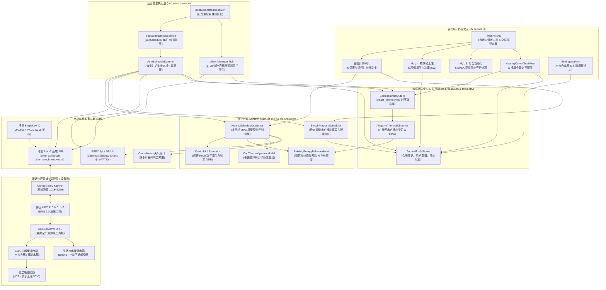
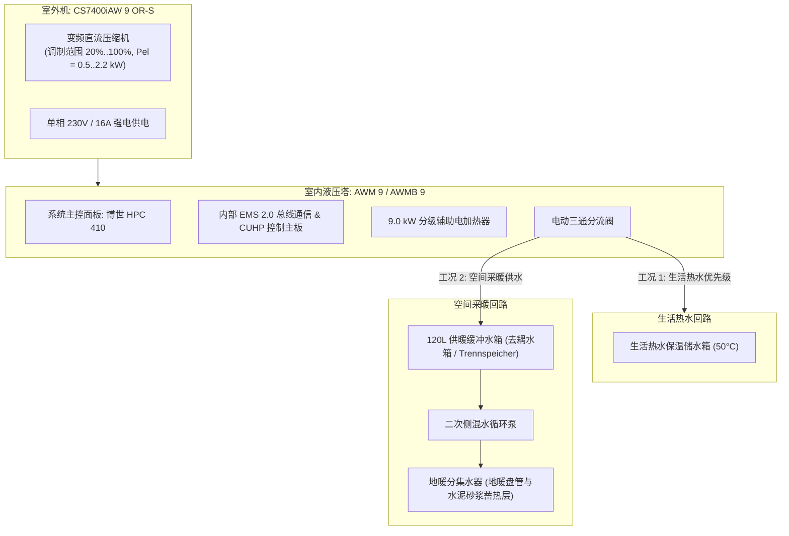

# BREAST Heatpump 系统架构技术文档

*语言 / Languages: [English](ARCHITECTURE.md) | [Deutsch](ARCHITECTURE_DE.md) | **中文** |*

本文档详细描述了 **BREAST Heatpump**（*Bosch Reverse Engineered API Smart Tool for Heatpump*）原生 Android 应用程序的软件系统架构、数据流动机制、后台自主调度守护进程以及实体热泵供暖系统的物理水路集成。

---

## 1. 系统总体架构拓扑图

---

## 2. 系统核心模块解析

### 2.1 表现层界面交互 (`de.breast.ui`)
* **`MainActivity.kt`**：
  * 基于纯代码编写的响应式 Android 视图树，内建自适应调色板（`UiPalette`），完美兼容**浅色/深色主题**与 **Android 15 沉浸式边缘布局（Edge-to-Edge）**，通过 `WindowInsetsCompat.Type.ime()` 实现软键盘弹出时的平滑视图避让与滚动防遮挡。
  * **卡片 1（状态仪表盘）**：实时展示博世 SingleKey ID 鉴权凭据状态、当前生效设定温度及最近同步时间戳。
  * **卡片 2（温度与运行时长控制）**：
    * 舒适采暖目标温度滑块（`15.0°C .. 30.0°C`，步长 `0.5°C`）。
    * 每日目标开机运行时长滑块（`0.5 h .. 16.0 h`，步长 `0.5 h`）。
  * **卡片 3（日程可视化看板）**：渲染今日与明日的最优开机窗口、全天平均加权电价、预估日均用电成本（欧元）及下发到硬件的具体开关时间点；内建实体温控器手动篡改检测与防误触“连续按3次确认覆盖”防护屏障。
  * **卡片 4（每日运行预算与设备额定功率）**：
    * 每日用电花费上限硬约束输入框（€/天）。
    * 动态功率模型与平均吸入电功率输入框（kW），支持自动变频功率调制（`Auto (~0.6kW)`）或手动固定数值覆盖。
    * 配置了即时 `TextWatcher` 文本监听器，输入即刻落盘保存，无需用户手动收起键盘或移开焦点。
  * **卡片 5（后台自动化与 EPEX 现货同步）**：每小时守护进程总开关、系统电量无限制优化快捷跳转、全周 7 天热泵日程检查器。
  * **卡片 6（供热特性曲线与实时工况遥测）**：嵌入式交互特性曲线图与室外温、供水温、回水温、温差 $\Delta T$、压缩机调制百分比等传感器标签。
  * **卡片 7（开发者控制台）**：可折叠折叠面板，包含遥测采集主开关、高频采样周期滑块（`1 分钟 .. 60 分钟`）与本地 SQLite 数据库清空工具。
* **`HeatingCurveChartView.kt` 与 `HeatingCurveFullscreenActivity.kt`**：
  * 精确绘制博世/布德鲁斯官方非线性物理供热曲线数学模型：
    $$T_{\text{供水}} = T_{\text{基准}} + \frac{T_{\text{设计}} - T_{\text{基准}}}{(-10 - 20)^\alpha} \cdot (T_{\text{室外}} - 20)^\alpha + \Delta T_{\text{平移}}$$
  * 横屏全屏模式支持 HPC 410 官方标准参考曲线 [1–5]、稳态工况点与瞬态升温散点、当前工况十字标尺，并与主界面图表持久化双向联动同步。
* **`SettingsActivity.kt`**：
  * **电价模型合成器与多元电价支持**：
    * 动态 EPEX 现货合成器：支持手动标定净基础工作电价（`Arbeitspreis`）、每月基础服务费（`Grundpreis`）与可配置增值税率（`MwSt`），并提供一键式预设方案（0% 免税、7% 优惠、19% 德国、20% 奥地利）。
    * 纯文本精准小数输入框（`EditText`）：针对所有电价参数全面采用输入框，原生兼容欧洲逗号 `,` 与国际小数点 `.`，彻底根除滑动条粗糙摩擦。
    * 峰谷平时段（ToU 峰谷电价）：支持尖峰（HT）与低谷（NT）双阶梯电价自定义、夜间波谷时段设定与周末全天低谷电价开关。自动合成分辨率为 15 分钟的时序电价，使 MPC 算法在无外部现货 API 时依然精准引导低谷储热。
    * 恒定固定电价（`Festpreis`）：支持单价数值直接设定，MPC 优化器纯粹基于卡诺循环 COP 能效比与太阳辐射增益安排最佳开机时机。
    * 实时合同信件公式预览：直观展示合同测算公式、0 欧分现货基准保底含税价、5 欧分现货参考交付价及月度固定费用。
  * **实测模型标定与遥测参数调节**：
    * 夜间降温回水分析与 25,000 点历史贝叶斯锚点建筑物热损失自动解算。
    * 变频压缩机调制率 PID 模型标定，提供 2x2 核心指标看板与动态温度工况走廊推演表。
    * 运行优化偏好四分段切换（舒适度、均衡、能效优先、预算优先）。
    * 地暖蓄热超充限值调节、寄生负载基准功耗设定与外接实体电表校准支持。
  * **Android 15 沉浸式主题与窗口架构**：
    * 声明专用 `@style/Theme.BreastApp` 主题（继承自 `@android:style/Theme.DeviceDefault.DayNight`），配置 `windowNoTitle=true` 与 `windowActionBar=false`。
    * 窗口边缘边距完美适配状态栏与前置摄像头挖孔屏切口（`WindowInsetsCompat.Type.displayCutout()`）。
    * 精简导航入口：顶部保留单一标准 `⚙ 设置` 按钮（移除了主界面仪表盘多余的重复按钮）。
    * 遥测标定徽章行（`HorizontalScrollView`）支持水平滚动并强制单行垂直居中（`Gravity.CENTER_VERTICAL`），防止屏幕空间不足导致的文字竖排与布局错位。

---

### 2.2 优化计算引擎 (`de.breast.optimizer`)

> [!NOTE]
> 有关建筑物平衡零线锚点（$\Delta t = 0$）、净套利不等式边界、地暖砂浆层蓄热相移延迟（2.5 小时）以及德国动态浮动电价税费结构的完整物理与数学推导，请参阅专用系统技术规格书：[HEAT_PUMP_OPTIMIZATION_PLAN.md](HEAT_PUMP_OPTIMIZATION_PLAN.md)。

#### A. 全局统筹优化器 (`HolisticScheduleOptimizer.kt`)
* 基于**模型预测控制（MPC）**算法架构，遍历全天所有候选连续开机运行窗口，通过多目标效用函数进行综合寻优：
  $$J = w_{\text{budget}} \cdot J_{\text{budget}} + w_{\text{cop}} \cdot J_{\text{cop}} + w_{\text{comfort}} \cdot J_{\text{comfort}}$$
* **多目标子项数学定义：**
  1. **经济效用 ($J_{\text{budget}}$)**：定义为窗口内每度电平均花费（$\bar{c}_{\text{gross}}$，欧分/kWh）结合晚间电价高峰溢价惩罚，并引入显式的欠充运行时长惩罚：
     $$\text{Penalty}_{\text{deficit}} = 2.5 \cdot (\max(0, t_{\text{目标}} - t_{\text{实际}}))^{1.6}$$
     引导优化器在满足用户目标采暖时长的前提下精准锁定最廉价的电价低谷，避免因贪婪最小化绝对金额而发生时长严重缩水。
  2. **能效效用 ($J_{\text{cop}}$)**：归一化热泵能效指数，优先偏向室外气温较高的午后窗口以降低压缩机扬程。
  3. **舒适度效用 ($J_{\text{comfort}}$)**：基于建筑物散热模拟，严厉惩罚室内温度低于设定目标的降温区间。
* **四种预设偏好模式与比例扩展走廊：**
  * **非负弹性走廊（$+0.0\text{ h}$ 刚性底线）**：全模式严格将最小运行走廊硬性锚定在用户滑块设定时长，坚决杜绝温和天气下时长自发收缩或塌陷。
  * **调度器步长量化协调（Harmonized Quantizer）**：离散化基准步长 $Q = 0.5\text{ h}$（$30\text{ 分钟}$）将连续比例扩展公式 $\Delta H = \operatorname{round}\left(\frac{T_{\text{目标}} \cdot r}{Q}\right) \cdot Q$ 与界面调节滑块及 15 分钟栅格槽位无缝对齐。
  * **舒适优先（Comfort Priority）**：$w = [0.15, 0.25, 0.60]$，扩展比例 $r = +20\%$，走廊区间 $[0.0\text{h}, \text{quantize}(0.20 \cdot T_{\text{目标}})]$。极致平稳室内体感，杜绝居住时段地面发凉。
  * **均衡模式（Balanced，推荐）**：$w = [0.35, 0.35, 0.30]$，扩展比例 $r = +25\%$，走廊区间 $[0.0\text{h}, \text{quantize}(0.25 \cdot T_{\text{目标}})]$。在现货电价、卡诺 COP 能效提振与室内舒适度之间取得最佳平衡，适度向上吸纳午间太阳能光伏低电价时段。
  * **能效优先（Efficiency / Bang for Buck）**：$w = [0.15, 0.35, 0.50]$，扩展比例 $r = +35\%$，走廊区间 $[0.0\text{h}, \text{quantize}(0.35 \cdot T_{\text{目标}})]$。最大化每欧元实际产热量（$\frac{\text{COP}}{c_{\text{gross}}}$），引入显式时长奖励项，鼓励在正午及午后光热最高峰（$10:00\text{–}16:30$）以轻载变频（$25\%\text{–}35\%$）长周期平稳巡航，同时完全受控于预算。
  * **预算优先（Budget Priority）**：$w = [0.70, 0.15, 0.15]$，扩展比例 $r = +0\%$。**严格标称时长锁定**（$[0.0\text{h}, 0.0\text{h}]$，绝对锁定用户设定的目标时长滑块），在全天寻找电价最低的连续窗口，杜绝非预算驱动的随意时长伸缩。
* **双轨 24 小时全天总能耗核算**：明确将主加热时段（Window）能耗及费用与包含全天 24 小时二级地暖泵及控制板能耗（$50\text{ W}$ 寄生基线功耗）的整日总能耗清晰双轨展示。
* **热力学审计弹窗第 5 节**：实时展示动态走廊配置参数、模式扩展比例、量化步长、时隙搜索范围及最终执行的时长增量。
* **两阶段预算评估与边际成本边缘切削（Marginal Cost Edge Shaving）：**
  * **第一阶段（走廊评估）**：严格在既定时长走廊内寻找最优候选窗口。只要有走廊窗口未超出 `dailyBudgetEuro`，立即选定最优窗口并设置 `budgetCutMinutes = 0`（杜绝虚假预算截断上报）。
  * **第二阶段（边际成本边缘切削）**：仅当走廊内的所有候选窗口均突破 `dailyBudgetEuro` 时触发。优化器以走廊内绝对电费最低的候选窗口为基准，比较窗口首端（$S$）与尾端（$E-1$）单位有效热量的边际购电成本：
    $$c_{\text{heat}}(t) = \frac{c_{\text{gross}}(t)}{\text{COP}(t)}$$
    若 $c_{\text{heat}}(S) \ge c_{\text{heat}}(E - 1)$ 则切除起始端 15 分钟槽位，否则切除末端 15 分钟槽位，循环迭代直至预估总电费 $\le \text{dailyBudgetEuro}$（或触及 90 分钟最小连续运行防频繁启停底线）。标记 `isBudgetForcedCut = true` 并精准计算记录 `budgetCutMinutes`。

#### B. 物理热力学仿真模型与数字孪生
* **`ControlUnitSimulator.kt`（闭环控制器数字孪生）**：
  * 深度重构博世 HPC 410 / Rego 控制器底层状态机。
  * 严格遵循基于供水目标曲线的回水温控逻辑，包含回水切入启机滞后（$-1.2\text{ K}$）与超温停机（$+0.5\text{ K}$）迟滞区间。
  * 求解混凝土砂浆层动态热传导常微分方程（ODE）：
    $$C_s \frac{dT_s}{dt} = \dot{Q}_{\text{in}} - \dot{Q}_{\text{floor}}$$
  * 仿真停机待机电气底噪基载功耗（15 W）。
* **`BuildingEnergyBalanceModel.kt`（建筑物热平衡模型）**：
  * 三状态建筑物热惰性模型，动态计算围护结构散热速率：
    $$Q_{\text{损耗}}(t) = H \cdot (T_{\text{室内}}(t) - T_{\text{室外}}(t))$$
  * 仿真停机保温阶段地暖水泥砂浆层与 120L 缓冲水箱的温度衰减历程。
* **`CopThermodynamicModel.kt`（热泵 COP 热力学模型）**：
  * 基于卡诺逆循环理论计算理论 COP 与温升扬程关联：
    $$\text{COP}(t) = \eta_C \cdot \frac{T_{\text{供水}}(t) + 273.15}{T_{\text{供水}}(t) - T_{\text{室外}}(t)}$$
    其中系统热力学完善度取 $\eta_C \approx 0.45 - 0.52$。
* **经验 COP 倒数插值与变频动态学**：
  * 摒弃僵化的固定功率假设，基于博世官方能源数据库整月实测数据（全月制热 $448\text{ kWh}_{\text{th}}$、压缩机耗电 $64\text{ kWh}_{\text{el}}$、平均月度 COP $7.00$）进行倒数扬程热力学回归：
    $$\text{COP}(\Delta T_{\text{lift}}) = \frac{1}{0.0068 \cdot (T_{\text{供水}} - T_{\text{室外}}) + 0.0062}$$
    连续平滑连接温和秋季（$16\text{ K}$ 扬程下 COP 达 $\approx 8.70$）与深冬极寒（$35\text{ K}$ 扬程下 COP $4.09$）。
  * 严谨模拟博世 CS7400iAW 变频压缩机 **`28.0%`** 的物理最低调制下限（约 $25\text{ Hz}$），对应秋季巡航工况制热量 $\dot{Q}_{\text{min}} \approx 3.0\text{ kW}_{\text{th}}$、压缩机电功率仅 $P_{\text{el}} \approx 0.35\text{ kW}$。
  * 动态计算压缩机耗电并叠加常开基准寄生功耗（$P_{\text{parasitic}} = 50\text{ W}$，约 $1.20\text{ kWh/天}$），覆盖地暖泵及控制板能耗，并预留独立分电表参数校准接口。

#### C. 静态规划调度器 (`SwitchProgramScheduler.kt`)
* 将全天离散化为 96 个 15 分钟栅格槽位（`RasterSlot`）。
* 在非统筹模式下严格贴合用户滑块指定的开机时长，寻找纯电费绝对值最低的连续时段。
* 支持设置每日预算上限时的自动逐步阶梯裁剪（最低保留 90 分钟防频繁启停底线）。
* 强制将全天最末的 23:45 槽位设为关机点，杜绝开启状态意外穿透跨日。

---

### 2.3 遥测采集与热工诊断引擎 (`de.breast.telemetry`)
* **`HeatPumpTelemetrySnapshot.kt`**：不可变时序数据实体，记录室外温、供水温、回水温、冷凝温度、温差 $\Delta T$、变频调制率（%）、当前负载需求（`ch` 地暖、`dhw` 热水、`idle` 待机）以及该时刻现货电价。
* **`SqliteTelemetryStore.kt`**：本地轻量级 SQLite 时序数据库（`breast_telemetry.db`），基于时间戳构建索引，支持毫秒级范围查询与一键导出标准 CSV。
* **`HeatingCurveAnalyzer.kt`**：
  * 对比工况点与博世官方地暖技术规范，并在停机工况下追踪回水温度自然衰减速率（$\Delta T_{\text{回水}} / \Delta t$）评估建筑蓄热保温性能。
  * **设定水温一致性纯净过滤**：剔除历史遥测中目标设定水温被手动修改或处于过渡态的脏数据行，确保供热曲线只基于稳态工况拟合。
  * 将夜间温降估算无缝委托给 `SetbackHeatLossEstimator` 进行严格天文黑夜与工况准入校验。
* **`SetbackHeatLossEstimator.kt`**：
  * **NOAA 天文太阳天顶角物理算法**：精准解算用户经纬度日落及日出时刻；强制约束仅从日落后 $\ge 2\text{ 小时}$ 开始采纳样本，彻底消除日照辐射与外墙白天热惰性瞬态干扰。算法自动跨午夜无缝拼接连续降温区间（如 19:00 至次日 04:15）。
  * **严格夜间回退（Setback）工况校验**：严密核验热泵真实处于低温回退状态（设定水温 $T_{\text{setpoint}} \le 18.5^\circ\text{C}$ 或 $\le T_{\text{comfort}} - 2.0\text{ K}$，压缩机关闭 $0\%$，地暖与生活热水均待机，水路回路完全均温 $\le 1.5\text{ K}$）。一旦舒适供暖恢复（如 04:15 CET），数据流立即截断，严禁舒适期混入。
  * **模型 3：2R2C 状态空间动态热容观测器**：平滑解耦水泥找平层主动释热与全屋热平衡衰减物理过程：
    $$\alpha = \left(1.0 - \frac{\max(0.0, T_{\text{回水, 平均}} - T_{\text{舒适}})}{\Delta T_{\text{充热}}}\right).coerceIn(0.0, 1.0)$$
    $$C_{\text{eff}} = C_{\text{水泥层}} + \alpha \cdot C_{\text{室内}}$$
    当地面温热充热（$T_{\text{回水}} \ge T_{\text{舒适}} + 1.0\text{ K}$）时，$C_{\text{eff}} = C_{\text{水泥层}} = 4.8\text{ kWh/K}$。当地面已冷透降至室温（$T_{\text{回水}} \le T_{\text{舒适}}$）时，全屋建筑外壳共同向外衰减，$C_{\text{eff}} = C_{\text{水泥层}} + C_{\text{室内}} = 13.3\text{ kWh/K}$。
  * **全区间最小二乘连续线性回归**：基于区段内全部 $N$ 个连续数据点最小二乘拟合降温速率与确定系数 $R^2$（$R^2 \ge 0.70$，降温速率 $\ge 0.04\text{ K/h}$）。
  * **多夜 $R^2 \times \text{时长}$ 加权回归**：跨多夜整合多段有效黑夜降温段，输出高可信度加权建筑热损失指标（$W/K$），并格式化为本地时区（CET）时间段展示。
* **`AdaptiveThermalObserver.kt`**：
  * **连续在线回水自适应学习**：监听实时遥测数据流，在夜间低温回退阶段（日落后 $\ge 2\text{ 小时}$ 直至次日清晨启机）持续追踪回水温度自然衰减过程。
  * **指数移动平均（EMA）参数迭代**：实时拟合降温速率，在线更新建筑物散热系数 $H_{\text{bld}}$ 与衰减常数 $\kappa$（更新权重 $\alpha_{\text{learn}} = 0.20$），仅采纳确定系数 $R^2 \ge 0.65$ 的高置信度物理降温段。
  * **闭环模型参数注入**：将实时估算的水泥砂浆层回水温度直接注入 `BuildingEnergyBalanceModel`，持续校准需热量预测函数，实现零人工介入的自进化闭环。
* **寄生基线功耗与独立电表校准架构**：
  * 将未计入博世内部电表的常开辅助负载（二级地暖循环水泵 ~25W、主板及网关控制底噪 ~15W）与压缩机主回路彻底解耦。
  * 引入宽裕的 50W 经验常开基准功耗常数（$P_{\text{parasitic}} = 50\text{ W}$，折合 ~$1.2\text{ kWh/天}$）。
  * 在 `UserSettingsStore` 与 `HolisticOptimizationConfig` 中提供预留校准变量，便于用户接入物理分路电表（如 Shelly 3EM、Eastron SDM）后直接进行实测参数覆写。

---

### 2.4 自主后台守护进程 (`de.breast.daemon`)
* **`AutoScheduleDaemon.kt`**：每小时运行的价格同步状态机，具备全套幂等安全特性：
  * 计算当前参数与已下发计划的数字特征签名。
  * 若今日计划已被成功下发，后台守护进程绝不会在运行时重复覆盖打扰当前供暖。
  * 当下午欧洲日前电价发布后（12:00–15:00 CET），自动推算并写入明日最优日程。
  * 一旦检测到用户在实体控制器或博世官方 App 进行了手动调节，自动挂起同步以防冲突。
* **`SpotScheduleJobService.kt`**：基于 Android 官方 `JobScheduler` 的常驻后台唤醒服务，极低功耗。
* **`AlarmManager` 高精度采集器**：利用 `AlarmManager.setAndAllowWhileIdle()` 机制穿透系统的 Doze 深度休眠，精确在设定的周期（`1 .. 60 分钟`）唤醒采集硬件状态。
* **`BootCompletedReceiver.kt`**：系统开机或应用更新后自动恢复后台调度与数据采样。

---

### 2.5 接口与身份鉴权层
* **`SingleKeyAuthManager.kt`**：实现博世 SingleKey ID OAuth2 PKCE（`S256`）免跳转内嵌登录拦截、离线 Token 安全落盘与基于 `refresh_token` 的无感自动轮换。
* **`PointTApiClient.kt`**：博世 PointT 云端 REST 客户端（`pointt-api.bosch-thermotechnology.com`），支持现代 Connect-Key K30 网关的原生顶层 JSON 数组提交及传统对象封装自动降级。
* **`SpotPriceClient.kt`**：支持三源冗余拉取德国现货电价（Vattenfall Davis、Fraunhofer Energy-Charts 与 aWATTar），并提供可自定义的电价合成器 `ElectricityTariffConfig`（支持任意增值税率、基础电网费与售电公司溢价调节）。同时支持峰谷平时段（ToU 峰谷电价）与固定电价模型并自动生成 15 分钟合成电价时序。
* **`WeatherForecastClient.kt`**：对接 Open-Meteo 高精度气象接口，拉取未来 48 小时逐小时室外气温预报供 MPC 算法预测。

---

## 3. 物理暖通供热系统集成

本软件针对以下典型的现代低能耗户式空气源热泵系统拓扑量身定制与控制：

### 120L 缓冲水箱的水力去耦原理
* 当系统进入生活热水（DHW）加热周期时，电动三通阀切换至热水水箱。此时二次侧循环水泵持续从 120L 缓冲水箱抽取存量热量循环送入地暖，确保室内地板供水毫无中断。
* 结合混凝土地暖层巨大的蓄热热惰性，即使热泵机组完全停机数小时或满负荷加热热水，室内体感温度也能保持恒定平稳。
* **协同统一日程策略**：将地暖采暖与生活热水集中安排在全天最便宜的电价波谷窗口内协同运行，在最大化节省用电开销的同时，消除无序启停造成的设备机械疲劳损耗。

### 生活热水（DHW）加热周期结束后的水力切换与传感器降温物理机理
* **表面管路快速降温假象**：在生活热水周期中，一次侧水路处于高温工况（$50^\circ\text{C}-58^\circ\text{C}$），而地暖回路在没有热量补充下持续向室内散热，回水温度自然回落至室温水平（$22^\circ\text{C}-25^\circ\text{C}$）。当热水烧满、电动三通换向阀旋转切回采暖侧时，一次侧循环水泵立即将缓冲水箱和地暖回水管中的低温水冲刷过室内塔温感探头（`T_supply`、`T_return`），导致测量温度在几十秒内从 $55^\circ\text{C}$ 暴跌至 $23^\circ\text{C}$。这纯属水路切换带来的传感器瞬态冲刷，并非热水箱失温。
* **压缩机降频/停机与压力平衡延时**：在三通阀转动换向期间，主控电脑会指令压缩机降至最低频率或暂时停机，以防止系统高压管路突变触发高压保护（`HD-Wächter`）及板换热冲击。系统内建约 3 分钟的防频繁启停平衡停机保护时间。
* **采暖再启动判定**：一旦地暖低温回水流经回水温度传感器（`TR1`/`TC0`），HPC 410 控制器比对发现当前回水温度远低于采暖曲线计算出的目标回水温度，且差值超过回水启停回差（$\ge 1.2\text{ K}$），因此平衡延时一过，控制器便会立即指令压缩机安全平稳重启，投入空间供暖循环。
