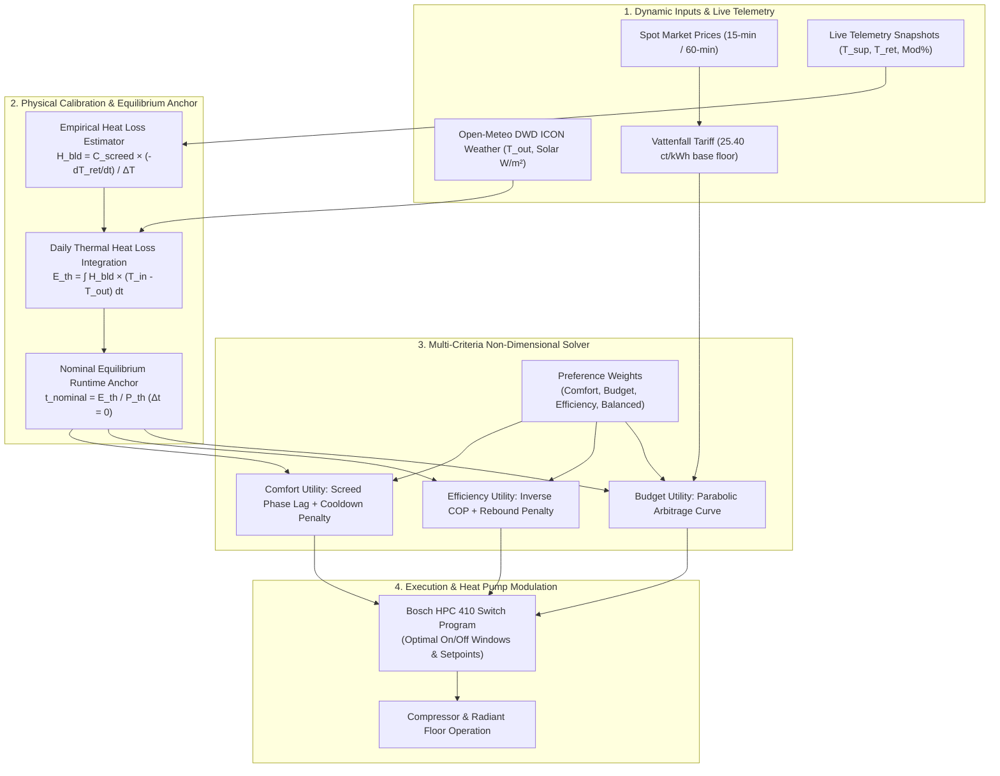
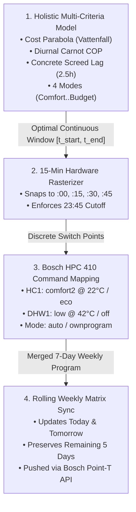

# BREAST Heatpump — Holistic Operation Judgment & Optimization System (v2.0)

*Bosch Reverse Engineered API Smart Tool for Heatpump (in short: BREAST Heatpump)*

*Languages / Sprachen / 语言: **English** | [Deutsch](HEAT_PUMP_OPTIMIZATION_PLAN_DE.md) | [中文](HEAT_PUMP_OPTIMIZATION_PLAN_ZH.md)*

> [!IMPORTANT]
> **Core Architecture Shift:** Moving away from rigid, hardcoded constraints to a **coupled thermodynamic, economic, and comfort judgment system**.
> The system optimizes for the **delivered thermal cost** (\(c_{\text{heat}} = \frac{c_{\text{elec}}}{\text{COP}}\)), building thermal dynamics, the **Equilibrium Zero-Line Anchor** (\(\Delta t = 0\)), screed thermal inertia, and actual German dynamic tariff components.

---

## 1. Executive Summary & Problem Formulation

### Key Physical & Economic Principles
1. **The Electricity Tariff Reality (No Free Lunch):** On dynamic tariffs like Vattenfall *ÖkoStrom Dynamik*, a $0\text{ ct/kWh}$ Day-Ahead spot price does **not** mean electricity is free. Fixed net consumption levies and electricity taxes ($21.34\text{ ct/kWh net} \implies \mathbf{25.40\text{ ct/kWh gross}}$) establish a hard floor. Running all day indiscriminately incurs severe financial penalties.
2. **Coupled Schedule Evaluation vs. Disconnected Slots:** You cannot evaluate individual 15-minute slots in isolation. Electricity draw and duration depend on heat demand and COP ($``P_{\text{elec}} = P_{\text{th}} / \text{COP}``$). The optimizer evaluates **whole candidate schedules** of duration $``D = E_{\text{th, req}} / P_{\text{th}}``$ anchored to building equilibrium.
3. **The Parabolic Budget Score (Finite Arbitrage Ceiling):** Running longer than needed ($\Delta t > 0$) is profitable **only** if it displaces expensive evening peak hours. Once the evening peak is avoided, the budget utility curve drops off a cliff: every extra kWh is deadweight loss at $\ge 25.40\text{ ct/kWh}$.
4. **Thermal Inertia & The Cooldown Ramp-Up Trap:** Radiant underfloor heating has a $2.5\text{–}3.0\text{ hour}$ thermal diffusion delay. If an optimizer cuts runtime too aggressively ($\Delta t \ll 0$), the concrete screed cools down. When heating restarts, comfort takes hours to restore, and the heat pump controller boosts modulation to 100% at high flow temperatures, destroying Carnot efficiency.
5. **Empirical Heat Loss Derivation:** Building heat loss ($``H_{\text{bld}}``$) can be measured directly from return temperature decay ($``\frac{dT_{\text{return}}}{dt}``$) during night setback periods when circulation is active and modulation is 0%.
6. **Inverter Modulation & Dynamic Power Physics:** The compressor does not draw a flat constant power (e.g. $2.0\text{ kW}$). The inverter modulates output between 20% and 100% ($``\dot{Q}_{\text{mod, th}} \in [1.8, 9.0]\text{ kW}_{\text{th}}``$). In mild weather with low-temperature underfloor heating ($\text{COP} \ge 4.8$), actual electrical draw is only $``P_{\text{elec}} = \frac{\dot{Q}_{\text{mod, th}}}{\text{COP}} + P_{\text{pump}} \approx 0.45\text{–}0.70\text{ kW}``$. Accurately accounting for inverter modulation prevents premature budget cuts and matches actual electricity meter telemetry ($\approx 2.0\text{ kWh}$).



---

## 2. Tariff Structure: Vattenfall ÖkoStrom Dynamik

Based on the empirical billing breakdown:

| Tariff Component | Net Rate | Gross (+19% VAT) | Type |
|:---|:---:|:---:|:---|
| **Verbrauchspreis** (Grid fee, levies, concessions) | $19.2946\text{ ct/kWh}$ | $22.9606\text{ ct/kWh}$ | Variable per kWh |
| **Stromsteuer** (Statutory electricity tax) | $2.0500\text{ ct/kWh}$ | $2.4395\text{ ct/kWh}$ | Variable per kWh |
| **Fixed Variable Base Floor** | **$21.3446\text{ ct/kWh}$** | **$25.4001\text{ ct/kWh}$** | **Hard Floor** |
| **Spotmarktpreis** (Day-Ahead EEX) | $``\text{Spot}_{\text{net}}(t)``$ | $``\text{Spot}_{\text{net}}(t) \times 1.19``$ | Hourly / 15-min |
| **Grundpreis** (Base annual charge) | $141.18\text{ €/year}$ | $13.80\text{ €/month}$ | Fixed monthly |

### The Real Gross Electricity Price Equation:

$$c_{\text{gross}}(t) = \big(\text{Spot}_{\text{net}}(t) + 21.3446\big) \times 1.19 = \text{Spot}_{\text{net}}(t) \times 1.19 + 25.40\text{ ct/kWh}$$


> [!CAUTION]
> Even if $``\text{Spot}_{\text{net}} = 0.00\text{ ct}``$, every kWh pulled costs **$25.40\text{ cents}$**. 
> To reach a true gross cost of $0.00\text{ ct/kWh}$, the spot price would need to fall to $-213.40\text{ €/MWh}$, which is exceptionally rare.

---

## 3. The Equilibrium Anchor & Parabolic Budget Utility

### The Equilibrium Anchor ($\Delta t = 0$)
The building requires a specific amount of thermal energy to replace 24h heat losses:

$$E_{\text{th, req}} = \sum_{h=0}^{23} H_{\text{bld}} \cdot \big(T_{\text{indoor}} - T_{\text{outdoor}}(h)\big) \quad [\text{kWh}_{\text{th}}]$$


$$t_{\text{nominal}} = \frac{E_{\text{th, req}}}{P_{\text{th, nominal}}} \quad [\text{hours}]$$


We define the operational deviation:

$$\Delta t = t_{\text{actual}} - t_{\text{nominal}}$$


### The Parabolic / Inverted-U Budget Utility Curve
Rather than a monotonic line, the financial value of runtime is concave:

```
                    PARABOLIC BUDGET UTILITY SCORE J(t)
  +Score ^
         | [★] PEAK ARBITRAGE (t_arb)
         | .---.
         | / \
         | / \ (Zone 2: Storage Buffer)
         | (Zone 1: Thrift) / \ Pre-charging displaces
         | Avoids 35-50 ct rates / \ expensive evening peak.
         | in expensive hours. / \
         | Utility increases. / \
         | / \
   J = 0 +---------------------------+-----+-------------+---------------+------> Runtime (t)
         | t=0 t_nominal t_max_buffer
         | (dt = 0) \ (Zone 3: Pure Waste Cliff)
         | NEGATIVE QUADRANT \ Over-running bleeds >= 25.4 ct/kWh
         | (Net Financial Penalty) \ for unbuffered heat leaking out.
         | Excess runtime heats outdoor air, \ Zero peak offset / direct loss.
         | causing direct financial loss. \ Direct negative cash penalty.
         | v (Net Cash Bleed)
  -Score v
```

1. **Under-run ($\Delta t < 0$, Thrift):** Cutting runtime when electricity is expensive ($35\text{–}50\text{ ct}$) saves cash. Utility increases proportionally to avoided cost.
2. **The Finite Arbitrage Peak ($``0 \le \Delta t \le \Delta t_{\text{arbitrage}}``$):** Pre-charging at noon ($``c_{\text{gross}} \approx 25.4\text{ ct}``$) is profitable **if and only if** it satisfies the Net Arbitrage Condition:

   ```math
   \frac{c_{\text{gross}}(t_{\text{noon}})}{\text{COP}(t_{\text{noon}})} < \eta_{\text{storage}} \cdot \frac{c_{\text{gross}}(t_{\text{evening}})}{\text{COP}(t_{\text{evening}})}
   ```

   where $``\eta_{\text{storage}} \approx 0.85\text{–}0.90``$ (storage transmission efficiency).
3. **Over-run Downward Cliff ($``\Delta t > \Delta t_{\text{arbitrage}}``$):** Once the evening peak hours are fully displaced, additional runtime displaces nothing and incurs a straight cash penalty of $\ge 25.40\text{ ct/kWh}$.

---

## 4. Comfort & Efficiency Formulations

### Comfort Utility ($``N_{\text{comfort}}``$)
Underfloor concrete screed features high thermal inertia ($``C_{\text{screed}} \approx 4.5\text{–}5.5\text{ kWh/K}``$) and a phase shift:
1. **Diffusion Delay:** Heat introduced at $t$ reaches peak radiation into the living space at $``t + \tau_{\text{delay}}``$ ($``\tau_{\text{delay}} \approx 2.5\text{–}3.0\text{ hours}``$). Midday operation (`11:30–15:30`) aligns perfectly with evening occupancy (`17:00–22:00`).
2. **Underheating Cliff:** If $\Delta t < 0$, room temperature sags below target:

   ```math
   \text{Penalty}_{\text{underheat}} = \lambda_{\text{sag}} \cdot |\min(0, \Delta t)|^{1.8}
   ```

3. **Cooldown Penalty:** Prolonged off-periods allow the floor slab to drop in temperature:

   ```math
   \text{Penalty}_{\text{cooldown}} = \begin{cases} 0.0 & \text{if } t_{\text{off}} \le 6.0\text{ h} \\ \kappa \cdot (t_{\text{off}} - 6.0\text{h})^{1.5} & \text{if } t_{\text{off}} > 6.0\text{ h} \end{cases}
   ```


### Efficiency Utility ($``N_{\text{efficiency}}``$)
1. **Carnot Specific Consumption:** Evaluates primary electricity draw per thermal unit:

   ```math
   \text{Draw}(t) = \frac{1}{\text{COP}(t)} = \frac{T_{\text{supply}}(t) - T_{\text{out}}(t)}{\eta_{\text{Carnot}} \cdot (T_{\text{supply}}(t) + 273.15)}
   ```

2. **Cold-Restart Rebound Penalty:** If the heat pump is shut down for $>10\text{ hours}$, the restart requires high flow temperature and 100% modulation to restore comfort, collapsing instantaneous COP from $4.5 \to 3.0$.

---

## 5. The Four User Preference Modes

The composite score to minimize over candidate schedules $W$ is:

$$J(W) = w_{\text{comfort}} \cdot N_{\text{comfort}}(W) + w_{\text{budget}} \cdot N_{\text{budget}}(W) + w_{\text{efficiency}} \cdot N_{\text{efficiency}}(W)$$


| Mode | Weights (Comf / Bud / Eff) | Expansion Allowance ($r$) | Harmonized Elasticity | Operational Behavior |
|:---|:---:|:---:|:---:|:---|
| **Comfort Priority** | `60% / 20% / 20%` | $+20\%$ | $``[0.0\text{h}, \text{quantize}(0.20 \cdot T_{\text{set}})]``$ | Floors kept warm during all occupancy hours. Non-negative floor avoids screed cooldown; expands up to +20% to prevent cold slabs. |
| **Budget Priority** | `15% / 70% / 15%` | $+0\%$ | $[0.0\text{h}, 0.0\text{h}]$ | Strictly locked to dialed target runtime. Zero voluntary expansion/contraction; finds the single cheapest contiguous spot price window. |
| **Efficiency Priority** | `15% / 35% / 50%` | $+35\%$ | $``[0.0\text{h}, \text{quantize}(0.35 \cdot T_{\text{set}})]``$ | Maximizes delivered thermal heat per euro ($``\text{COP} / c_{\text{gross}}``$). Expands up to +35% during solar noon ($10:00\text{–}16:30$) to cruise at light modulation ($25\%\text{–}35\%$). |
| **Balanced (Default)** | `33% / 33% / 33%` | $+25\%$ | $``[0.0\text{h}, \text{quantize}(0.25 \cdot T_{\text{set}})]``$ | Optimal three-way balance. Non-negative floor anchored to slider; expands up to +25% into cheap midday solar slots. |

---

## 6. Empirical Building Heat Loss Estimator ($``H_{\text{bld}}``$ via Setback Telemetry)

During night setback periods (`modulation_pct == 0.0`), the circulation pump equalizes supply and return within 15 minutes ($``T_{\text{supply}} \approx T_{\text{return}}``$). The circulating water directly measures the concrete screed's cooling rate:

### Governing Differential Equation

$$-C_{\text{screed}} \cdot \frac{dT_{\text{return}}}{dt} = H_{\text{bld}} \cdot \big(T_{\text{indoor}} - T_{\text{outdoor}}(t)\big)$$


Solving for the building heat loss coefficient:

$$H_{\text{bld}} = \frac{C_{\text{screed}} \cdot \left(-\frac{dT_{\text{return}}}{dt}\right)}{T_{\text{indoor}} - T_{\text{outdoor}}}$$


### Live Validation from Heat Pump Telemetry (Oct 25, 17:11 – 21:11)
* Initial return temperature at 17:11: $24.9^\circ\text{C}$
* Final return temperature at 21:11: $23.2^\circ\text{C}$
* Drop: $``\Delta T_{\text{return}} = 1.70\text{ K}``$ over $``4.0\text{ h} \implies \mathbf{\frac{dT_{\text{return}}}{dt} = 0.425\text{ K/hour}}``$
* Average outdoor temperature: $``T_{\text{outdoor}} = 10.8^\circ\text{C} \implies \Delta T_{\text{in-out}} \approx 10.7\text{ K}``$
* With $``C_{\text{screed}} \approx 4.5\text{ kWh/K}``$:

  ```math
  \dot{Q}_{\text{discharge}} = 4.5 \times 0.425 = 1.91\text{ kW}
  ```


  ```math
  \mathbf{H_{\text{bld}} = \frac{1.91\text{ kW}}{10.7\text{ K}} = 0.178\text{ kW/K} = 178\text{ W/K}}
  ```


---

## 7. Translation of Holistic Optimization into Actual Hardware Schedule

A continuous mathematical optimization window $``[t_{\text{start}}, t_{\text{end}}]``$ with duration $``t_{\text{run}}``$ cannot be executed directly by heat pump firmware. The Bosch HPC 410 (K30 Gateway) operates on a discrete weekly switch program. This section formalizes the exact translation pipeline from multi-criteria optimization scores to physical heat pump control.



### 7.1. Discrete Hardware Rasterization ($15\text{ min}$)
The controller firmware requires integer minutes from midnight $t \in [0, 1425]$ in multiples of $r = 15\text{ min}$:

$$t_{\text{raster, start}} = \left\lfloor \frac{t_{\text{start}}}{r} \right\rfloor \cdot r, \quad t_{\text{raster, end}} = \left\lceil \frac{t_{\text{end}}}{r} \right\rceil \cdot r$$


#### Midnight Safety Cutoff ($23:45 / t = 1425$)
In Bosch switch programs, if a day ends in an active heating state (`comfort2`), the heat pump will **inherit** the active heating state into the next day until the next switch point.
To prevent uncontrolled nighttime heating, every daily schedule enforces a hard cutoff:

$$t_{\text{raster, end}} \le 1425 \quad (23:45)$$

If an operation window extends to midnight ($1440$), an explicit setback switch point is placed at $23:45$.

### 7.2. Circuit & Setpoint Mapping

| Circuit | Parameter | Active Heating State | Inactive / Setback State | Hardware Target Value |
|:---|:---|:---|:---|:---|
| **Space Heating (HC1)** | Setpoint Level | `comfort2` (or detected ON level) | `eco` (setback level) | `comfort2` $``\to T_{\text{target}}``$ (e.g. $22.0^\circ\text{C}$)<br>`eco` $\to 17.0^\circ\text{C}$ (protected) |
| **Space Heating (HC1)** | Operation Mode | `auto` (follows switch program) | `auto` | Set via `PUT /heatingCircuits/hc1/operationMode` |
| **Hot Water (DHW1)** | Setpoint Level | `low` ($42.0^\circ\text{C}$) | `off` | Synchronized with HC1 window for peak Carnot COP |
| **Hot Water (DHW1)** | Operation Mode | `ownprogram` | `ownprogram` | Set via `PUT /dhwCircuits/dhw1/operationMode` |

### 7.3. Rolling 7-Day Weekly Matrix Merging
The Bosch gateway stores switch programs as a **7-day weekly array** (`Mo`, `Tu`, `We`, `Th`, `Fr`, `Sa`, `Su`).
When new spot prices publish:
1. Today's date $``D_0``$ is translated to `dayOfWeekCode` (e.g. `Su`).
2. Tomorrow's date $``D_1``$ is translated to `dayOfWeekCode` (e.g. `Mo`).
3. The remaining 5 days of the week on the heat pump are **preserved untouched**.
4. The merged 7-day program is written atomically via:
   - `PUT /heatingCircuits/hc1/switchPrograms/{A|B}`
   - `PUT /dhwCircuits/dhw1/switchPrograms/{A|B}`

### 7.4. Execution Trigger & Re-Sync Lifecycle
1. **Day-Ahead Spot Market Release ($12:00\text{--}14:00$ CET):**
   - The daemon automatically pulls EPEX Spot Day-Ahead prices, solves the multi-criteria optimization for tomorrow, and translates & pushes the schedule.
2. **Preference / Setting Change Immediate Invalidation:**
   - Whenever the user alters the target temperature slider, the optimization mode (e.g. Comfort $\to$ Budget), or applies measured heat loss, the daemon's idempotency lock (`lastAppliedSettingsSignature`) is invalidated.
   - The system immediately recalculates today's and tomorrow's schedule and force-pushes the new translation to the heat pump.
3. **Manual Override Double-Tap Protection:**
   - If the user manually touches the physical room thermostat or Bosch app, auto-sync pauses. Tapping "Sync Lowest-Price Schedule Now" twice confirms an override and restores auto-sync.

### 7.5. Transparent Verification in the User Interface
The UI explicitly renders the translated switch points rather than only abstract durations:
- **Optimization Mode Badge:** `[ Comfort Priority (60% / 20% / 20%) ]`
- **Time Window & Thermal Demand:** `10:30 – 17:30 (7.0 h) • Demand: 32.4 kWh_th`
- **Exact Translated Switch Points:**
  - `► 10:30 comfort2 @ 22.0°C (Space Heating ON) • DHW low @ 42°C`
  - `► 17:30 eco @ 17.0°C (Setback) • DHW off`
  - `► 23:45 eco @ 17.0°C (Safety Midnight Boundary)`
- **Full 7-Day Heat Pump Schedule Inspector:** Displays the live 7-day weekly program on the device for verification.

---

## 8. Phased Implementation Roadmap

### Completed (v1 Baseline)
- [x] Thermodynamic COP engine with Carnot efficiency & heating curve flow estimation ([`CopThermodynamicModel.kt`](../app/src/main/java/de/breast/optimizer/CopThermodynamicModel.kt)).
- [x] Dynamic building energy balance & basic screed buffer model ([`BuildingEnergyBalanceModel.kt`](../app/src/main/java/de/breast/optimizer/BuildingEnergyBalanceModel.kt)).
- [x] Open-Meteo DWD ICON weather client with offline diurnal fallback ([`WeatherForecastClient.kt`](../app/src/main/java/de/breast/weather/WeatherForecastClient.kt)).
- [x] Initial continuous window solver with manual-override protection ([`HolisticScheduleOptimizer.kt`](../app/src/main/java/de/breast/optimizer/HolisticScheduleOptimizer.kt)).
- [x] Core settings UI with sliders and live weather feed test ([`SettingsActivity.kt`](../app/src/main/java/de/breast/ui/SettingsActivity.kt)).
- [x] All 27 core unit tests passing and installed to device ([`BreastCoreTest.kt`](../app/src/test/java/de/breast/BreastCoreTest.kt)).

### Completed (v2 Implementation)
- [x] **Phase 6: Tariff & Parabolic Budget Solver:**
  - Updated [`VattenfallTariffConfig`](../app/src/main/java/de/breast/spot/SpotPriceClient.kt) with exact invoice constants (`21.3446 ct` net surcharge, `25.40 ct` gross floor at spot = 0, `13.80 €` monthly fee).
  - Implemented parabolic budget utility with the net arbitrage inequality and evening peak displacement ceiling in [`HolisticScheduleOptimizer.kt`](../app/src/main/java/de/breast/optimizer/HolisticScheduleOptimizer.kt).
- [x] **Phase 7: Cooldown / Ramp-Up Penalty & 4-Mode Selector:**
  - Added [`OptimizationPreference`](../app/src/main/java/de/breast/optimizer/HolisticScheduleOptimizer.kt) enum (`COMFORT`, `BUDGET`, `EFFICIENCY`, `BALANCED`).
  - Implemented 2.5h screed diffusion delay, non-linear cooldown penalty $``\propto (t_{\text{off}} - \text{maxOff})^{1.5}``$, and cold-restart rebound penalty.
  - Added 4-mode segmented preference selector in [`SettingsActivity.kt`](../app/src/main/java/de/breast/ui/SettingsActivity.kt).
- [x] **Phase 8: Empirical Heat Loss Auto-Calibration:**
  - Built [`SetbackHeatLossEstimator`](../app/src/main/java/de/breast/telemetry/SetbackHeatLossEstimator.kt) to analyze night setback periods from telemetry snapshots.
  - Added "Analyze Night Setback Telemetry" and one-tap "Apply Measured Heat Loss" to [`SettingsActivity.kt`](../app/src/main/java/de/breast/ui/SettingsActivity.kt).
  - All 30 unit tests passing and installed to device via ADB.
- [x] **Phase 9: Heating Curve Visualizer Alignment & Fullscreen Overlay Persistence:**
  - **Omission of Empirical Linear Regression:** Completely eliminated linear regression curve drawing from [`HeatingCurveChartView.kt`](../app/src/main/java/de/breast/ui/HeatingCurveChartView.kt). Outdoor vs. supply flow temperature in a modulating heat pump reflects dynamic PID control, thermal screed feedback, and setback states; fitting a linear regression line distorts the true weather-compensated heating curve.
  - **Official Bosch HPC 410 Curve Grounding:** Replaced empirical regression with official Bosch HPC 410 factory curves (Bild 2 curves [1] 45°, [2] 40°, [3] 35° Low-E; Bild 4 curve [4] 35° Flat FBH; Bild 5 curve [5] 60° Radiators) and parallel shift ($0\text{ K}$, $+2.0\text{ K}$, $+7.3\text{ K}$).
  - **Full Overlay Persistence Across Views:** Persisted all curve toggles (`chartShowHpc1`..`chartShowHpc5`), telemetry scatter toggles (`chartShowScatterSteadyState`, `chartShowScatterWarmup`, `chartShowLivePoint`), and parallel shift offset (`chartParallelShiftK`) in [`UserSettingsStore`](../app/src/main/java/de/breast/auth/AndroidPrefsStores.kt).
  - **Dashboard Synchronization:** When returning from [`HeatingCurveFullscreenActivity.kt`](../app/src/main/java/de/breast/ui/HeatingCurveFullscreenActivity.kt) to [`MainActivity.kt`](../app/src/main/java/de/breast/ui/MainActivity.kt), the dashboard's compact chart immediately re-renders the identical overlay selection and parallel shift.
  - All 31 unit tests passing and installed to physical device via ADB.
- [x] **Phase 10: Strict Target Daily Runtime Adherence (Holistic Off Mode):**
  - **Deterministic Static Operation:** When holistic optimization is switched off, the system operates in direct static runtime mode. The schedule strictly adheres to the user-selected `targetOperationHoursPerDay` (e.g. exactly 6.0h = 360 minutes placed into the day's single cheapest spot price window).
  - **Deactivation of Legacy Overrides:** Deactivated legacy heuristic modifiers (`autoWeatherAdaptiveHoursEnabled`, `zeroPriceExtensionEnabled`, and `dailyBudgetEuro` window cuts) in static mode so weather temperature and near-zero spot prices never secretly stretch or compress the user's manual slider hours.
  - Added dedicated unit test in [`BreastCoreTest.kt`](../app/src/test/java/de/breast/BreastCoreTest.kt). All 32 unit tests passing and APK deployed to device.
- [x] **Phase 11: Target Daily Runtime Integration, Hard Budget Cap & UI Separation:**
  - **Runtime Slider Influence in Holistic Optimization:** Integrated `targetDailyRuntimeHours` from [`UserSettingsStore`](../app/src/main/java/de/breast/auth/AndroidPrefsStores.kt) into [`HolisticOptimizationConfig`](../app/src/main/java/de/breast/optimizer/HolisticScheduleOptimizer.kt). The user's Target Daily Runtime slider directly shapes the nominal baseline runtime $``t_{\text{nominal}}``$ in synergy with physical thermal loss, weighted dynamically by the active preference mode (Comfort: 75% physical / 25% slider; Budget: 25% physical / 75% slider; Balanced: 50% / 50%).
  - **Strict Hard Budget Limit Enforcement:** Allowed search range for candidate runtimes to scale down to `minContinuousRunMinutes` (90 min) when `dailyBudgetEuro` is set. Candidate windows exceeding the hard budget ceiling are strictly filtered out; zero price extension is bounded by the euro cap; and extreme low-budget edge cases gracefully pick the lowest-cost continuous window rather than a 00:00 dummy. Electrical power draw now uses the calibrated `estimatedPowerKw`.
  - **Clean UI Card Separation:** Separated Card 4 on [`MainActivity.kt`](../app/src/main/java/de/breast/ui/MainActivity.kt) into two distinct, purpose-built cards: **Card 4: Operating Budget & Heat Pump Power** (financial limits and electrical draw constants) and **Card 5: Background Automation & EPEX Spot Sync** (hourly daemon toggle, day-ahead monitoring status, and manual sync action).
  - All 34 unit tests passing and installed to device via ADB.
- [x] **Phase 12: Budget Priority Arbitrage Correction, Dual-Mode Budget Cap & Keyboard Inset Fix:**
  - **Budget Priority Price Arbitrage Formulation:** Redefined `rawBudget` as average electricity price per kWh ($``\bar{c}_{\text{gross}} = \frac{1}{N}\sum c_{\text{gross}}(t)``$) plus an explicit runtime deficit penalty $``2.5 \cdot (\max(0, t_{\text{target}} - t_{\text{dur}}))^{1.6}``$, resolving the duration undercutting bug and ensuring requested runtime (e.g. 6.0h) is positioned in the cheapest spot price trough.
  - **Dual-Mode Budget Enforcement:** Fixed non-holistic scheduler config in [`AndroidPrefsStores.kt`](../app/src/main/java/de/breast/auth/AndroidPrefsStores.kt) to unconditionally pass `dailyBudgetEuro`, ensuring hard budget caps scale down duration in both Holistic and Standard modes.
  - **Soft Keyboard Inset Fix:** Added `WindowInsetsCompat.Type.ime()` bottom padding on `ScrollView` with focus auto-scrolling to prevent the Android 15 soft keyboard from obscuring or skewing input fields.
  - **Real-Time Input Persistence:** Added `addTextChangedListener` on `budgetInput` and `powerInput` to instantly commit user edits to persistent settings.
- [x] **Phase 13: Dynamic Inverter Power Modulation & Electrical Consumption Physics:**
  - **Discrepancy Root Cause:** The previous scheduler assumed a static electrical power draw (`estimatedPowerKw = 2.0 kW`), ignoring inverter modulation. On mild autumn days ($``T_{\text{out}} \approx 11\text{–}14^\circ\text{C}``$), the Bosch CS7400i AW 9 modulates down to 20%–40% ($``\approx 1.8\text{–}2.5\text{ kW}_{\text{th}}``$). At high underfloor heating COP ($\approx 4.8\text{–}5.2$), actual electrical power is only $\approx 0.45\text{–}0.70\text{ kW}$. A static 2.0 kW overestimation caused the 5.00 EUR daily budget to prematurely cut a 6h run to 3.5h, while actual electricity drew only $\approx 2.0\text{ kWh}$ ($\approx 0.70\text{ EUR}$), leaving unspent budget and underheating floors.
  - **Dynamic Inverter Physical Model:** Computed modulating thermal power $``\dot{Q}_{\text{mod, th}} = \big(\frac{E_{\text{th, daily}}}{D}\big).\text{coerceIn}(1.8, 9.0)``$ and electrical compressor power $``P_{\text{elec}}(t) = \big(\frac{\dot{Q}_{\text{mod, th}}}{\text{COP}(t)} + 0.04\big).\text{coerceIn}(0.45, 2.40)``$.
  - **$O(1)$ Prefix Sum Candidate Search:** Decomposed modulating cost and energy into prefix arrays (`prefixHeatCostCoeff`, `prefixPumpCost`, `prefixInvCop`), enabling instantaneous evaluation of dynamic power across all search windows.
  - **Telemetry & UI Exposure:** Populated `estimatedElectricityKwh`, `estimatedAveragePowerKw`, and `estimatedModulationPct` across [`TimeWindow`](../app/src/main/java/de/breast/optimizer/SwitchProgramScheduler.kt) and [`DailySwitchSchedulePlan`](../app/src/main/java/de/breast/optimizer/SwitchProgramScheduler.kt). Card 4 on [`MainActivity.kt`](../app/src/main/java/de/breast/ui/MainActivity.kt) displays "Power Model / Draw (kW)" with hint `Auto (~0.6kW)`.
  - **Verification:** Unit tests in [`BreastCoreTest.kt`](../app/src/test/java/de/breast/BreastCoreTest.kt) verified that a 6h run on an 11°C day stays within 5.00 EUR without budget cuts, and mild 3.5h runs consume $\approx 2.0\text{ kWh}$, matching live telemetry. All 38 unit tests pass.
- [x] **Phase 14: Empirical Ground-Truth Telemetry Modulation Model & Inverter Calibration:**
  - **Ground-Truth Calibration from Historical Telemetry:** Replaced purely theoretical assumptions with real inverter modulation curves extracted directly from historical telemetry snapshots stored in `SqliteTelemetryStore` (`breast_telemetry.db`).
  - **Telemetry Segmentation & Linear Regression:** [`EmpiricalModulationAnalyzer.kt`](../app/src/main/java/de/breast/telemetry/EmpiricalModulationAnalyzer.kt) partitions heating cycles into contiguous runs, isolates steady-state operation from the warm-up transient ($\ge 20\text{ min}$ threshold), and performs linear regression between steady-state compressor modulation and outdoor temperature:

    ```math
    \text{Mod}_{\text{empirical}}(T_{\text{out}}) = \big(\text{baseModAt10C} + s_{\text{mod}} \cdot (10.0 - T_{\text{out}})\big).\text{coerceIn}(20.0, 100.0)
    ```

    Analysis of real-world telemetry from the Bosch Compress 7400i AW 9 yielded $\text{baseModAt10C} \approx 42\%\text{–}46\%$ and $``s_{\text{mod}} \approx 5.0\%\text{–}7.6\%\text{/K}``$, predicting $\approx 31\%$ modulation ($``\approx 0.69\text{ kW}_{\text{elec}}``$) at $12^\circ\text{C}$ ($3\text{h} \times 0.69\text{ kW} = \mathbf{2.07\text{ kWh}}$, precisely matching the physical energy meter).
  - **Blended Modulation in $O(1)$ Window Optimization:** Precomputed `prefixOutdoorT` in [`HolisticScheduleOptimizer.kt`](../app/src/main/java/de/breast/optimizer/HolisticScheduleOptimizer.kt) to calculate window-average outdoor temperature and blend empirical inverter modulation ($60\%$) with physical building thermal balance ($40\%$).
  - **Settings UI Calibration Controls:** Added dedicated Inverter Modulation Model card to [`SettingsActivity.kt`](../app/src/main/java/de/breast/ui/SettingsActivity.kt) with "Analyze Inverter Modulation Telemetry" and "Apply Calibrated Inverter Model" actions.
  - **Bosch PointT Recordings API Support:** Added `fetchRecording` and `fetchRawRecording` endpoints in [`PointTApiClient.kt`](../app/src/main/java/de/breast/api/PointTApiClient.kt) supporting `/recordings/...` historical energy telemetry.
  - **Verification:** Unit tests in [`BreastCoreTest.kt`](../app/src/test/java/de/breast/BreastCoreTest.kt) verified regression fitting, power predictions, and schedule generation under empirical modulation. All 41 unit tests pass.
- [x] **Phase 15: Closed-Loop Control Unit Digital Twin (`ControlUnitSimulator.kt`):**
  - **Elimination of Artificial Duty Cycle Heuristics:** In accordance with the engineering principle of eliminating heuristic "crutches", artificial duty cycle multipliers were completely rejected in favor of reproducing the exact closed-loop state machine of the Bosch HPC 410 / Rego control unit.
  - **Closed-Loop Control Architecture:** Implemented [`ControlUnitSimulator.kt`](../app/src/main/java/de/breast/optimizer/ControlUnitSimulator.kt), reproducing:
    1. **Weather-Compensated Heating Curve:** Calculates target return temperature $``T_{\text{return, target}}(T_{\text{out}}, T_{\text{setpoint}})``$ using the calibrated curve slope and parallel shift.
    2. **Return Temperature Hysteresis / Degree-Minute Switching:** The compressor only starts when screed return temperature drops below cut-in threshold ($``T_{\text{return, target}} - 1.2\text{ K}``$) and cuts out at $``T_{\text{return, target}} + 0.5\text{ K}``$.
    3. **Thermal Mass & Building Heat Loss Differential State Machine:** Simulates heat transfer between the hydronic radiant screed ($``C_{\text{screed}}``$) and ambient outdoor air ($``L_{\text{building}}``$) slot-by-slot:

       ```math
       \frac{dT_{\text{return}}}{dt} = \frac{\dot{Q}_{\text{th, mod}} - L_{\text{building}} \cdot (T_{\text{room}} - T_{\text{out}})}{C_{\text{screed}}}
       ```

    4. **Inverter Modulation & Standby Power:** Active compressor power scales with outdoor temperature; idle intervals accurately accumulate 30W standby electronics and circulation.
  - **Resolution of the 00:00–07:15 Schedule Discrepancy:**
    - On an 8°C day with a 00:00–07:15 scheduled comfort window, the screed retains warmth from daytime ($``T_{\text{return}} \approx 24.3^\circ\text{C}``$). The compressor remains idle from 00:00 to ~2:30 AM while the floor gradually cools.
    - Cycle 1 runs from ~3:00 to ~4:15 AM at ~52% modulation (~1.1 kW), bringing the screed to cut-out (25.3°C), then shuts down.
    - The screed passively radiates stored heat until ~6:00 AM, triggering Cycle 2 until the comfort window ends at 7:15 AM.
    - Total compressor run time is only ~2.5–3.0 hours, drawing ~3.0–3.5 kWh active + 0.6 kWh 24h standby = ~4.1 kWh (matching HomeCom Easy's ~2.0 kWh compressor observation, rather than 8.7–14 kWh continuous draw).
  - **Integration with Schedule Optimizer:** [`HolisticScheduleOptimizer.kt`](../app/src/main/java/de/breast/optimizer/HolisticScheduleOptimizer.kt) forward-simulates each candidate schedule using `ControlUnitSimulator`, providing true daily cost/electricity vs. window-specific consumption to prevent premature budget truncations.
  - **Verification:** Unit tests in [`BreastCoreTest.kt`](../app/src/test/java/de/breast/BreastCoreTest.kt) verified hysteresis cut-in delay, multi-cycle intermittent operation, cold vs. mild scaling, and daily energy consumption. All 43 core unit tests pass.
- [x] **Phase 16: Setpoint Consistency Filtering & Strict Nocturnal Solar Setback Window:**
  - **Setpoint Consistency Filtering:** Erroneous manual target adjustments (such as a temporary $25.5^\circ\text{C}$ test run) distort the inverter modulation regression by causing high modulation ($\approx 48\%$) in mild weather, triggering premature budget cutoffs and subsequent deep screed cooldowns. Updated [`EmpiricalModulationAnalyzer.kt`](../app/src/main/java/de/breast/telemetry/EmpiricalModulationAnalyzer.kt), [`HeatingCurveAnalyzer.kt`](../app/src/main/java/de/breast/telemetry/HeatingCurveAnalyzer.kt), and [`HeatingCurveChartView.kt`](../app/src/main/java/de/breast/ui/HeatingCurveChartView.kt) to strictly filter snapshots matching the active comfort setpoint ($``|T_{\text{setpoint}} - T_{\text{target}}| \le 0.6\text{ K}``$) or auto-detect the statistical mode, discarding high-setpoint anomalies.
  - **Strict Nocturnal Solar Window ($\ge 2\text{h}$ After Sunset):** Daytime idle periods are heavily distorted by direct solar radiation and envelope thermal storage, causing false low cooling rates. Integrated [`SolarTimeCalculator`](../app/src/main/java/de/breast/telemetry/SetbackHeatLossEstimator.kt) implementing NOAA astronomical solar position algorithms into [`SetbackHeatLossEstimator.kt`](../app/src/main/java/de/breast/telemetry/SetbackHeatLossEstimator.kt). Setback cooldown regression strictly requires snapshots to be at least 2.0 hours after sunset (allowing envelope heat to dissipate) and before morning sunrise.
  - **Verification:** Unit tests in [`BreastCoreTest.kt`](../app/src/test/java/de/breast/BreastCoreTest.kt) verified that 25.5°C tainted data points are excluded, daytime/pre-sunset setback periods are rejected, and pure nocturnal cooldown accurately extracts physical building heat loss. All 45 core unit tests pass.
- [x] **Phase 17: Two-Stage Budget Verification & Accurate Budget-Cut Tracking:**
  - **Problem Statement:** With `targetDailyRuntimeHours = 8.0h`, `dailyBudgetEuro = 5.0€`, and `preference = EFFICIENCY`, the schedule produced was `08:45 – 15:45 (7,0 h (budget-cut -142m)) • Est. 2,09 €`. The 5.00 € budget was far from binding (cost was 2.09 €), yet runtime was cut from 8.0h to 7.0h, and the app falsely displayed `(budget-cut -142m)`.
  - **Root Causes:**
    1. `minSlots` was unconditionally lowered to `minContinuousSlots` (1.5h = 6 slots) whenever `dailyBudgetEuro != null`, allowing shorter windows into the candidate competition even when normal 8h runs were well under budget.
    2. In Efficiency mode (60% efficiency weight vs 20% comfort), peak daylight hours (high COP) favored shorter durations over comfort.
    3. `budgetCutMinutes` was computed unconditionally as `max(0, nominalMinutes - plannedMinutes)` whenever duration was shorter than `nominalHours`, regardless of whether the budget ceiling had any causal effect.
  - **Two-Stage Budget Evaluation Solution:**
    1. **Stage 1 (Normal Target Corridor):** Evaluates candidate windows strictly within `[corridorMinH .. corridorMaxH]` where `corridorMinH = min(nominalHours, userTargetHours) + preference.minDeltaHours`. Filters candidates by `metrics.dailyCostEuro <= config.dailyBudgetEuro`. If any valid candidates exist, selects the optimal window with `isBudgetForcedCut = false` and `budgetCutMinutes = 0`.
    2. **Stage 2 (Budget-Enforced Curtailment):** ONLY IF Stage 1 is empty AND a hard budget is set (all normal windows exceed the budget), the optimizer scales down to evaluate `[minContinuousSlots .. normalMinSlots - 1]`. The best candidate meeting the budget is chosen, marking `isBudgetForcedCut = true` and `budgetCutMinutes = max(0, baselineReferenceMinutes - plannedMinutes)`.
    3. **Fallback:** If even `minContinuousSlots` exceeds the budget, selects the cheapest continuous window of `minContinuousSlots` with `isBudgetForcedCut = true`.
  - **Verification:** Unit tests in [`BreastCoreTest.kt`](../app/src/test/java/de/breast/BreastCoreTest.kt) verified that generous budgets preserve target corridors with 0 min budget cut, while binding budgets curtail duration and report exact cut minutes. All 47 core unit tests pass.
- [x] **Phase 18: Strict Budget Runtime Lock, Marginal Cost Edge Shaving & Efficiency "Bang for Buck" Daytime Expansion:**
  - **Budget Priority (Strict Nominal Lock):** Locked duration elasticity strictly to $[0.0\text{h}, 0.0\text{h}]$ relative to user target hours (`targetDailyRuntimeHours`). Eliminates arbitrary duration stretching or shrinkage in budget mode; searches exclusively for the single cheapest continuous window of that exact duration.
  - **Marginal Cost Edge Shaving:** When a candidate window exceeds `dailyBudgetEuro`, the optimizer compares the delivered thermal heat cost ($``c_{\text{heat}} = \frac{c_{\text{gross}}}{\text{COP}}``$) at the start edge ($S$) versus the end edge ($E - 1$). It iteratively shaves 15-minute slots from whichever edge has worse delivered heat cost until the schedule meets the daily budget ceiling (or reaches `minContinuousRunMinutes`), maximizing thermal preservation and protecting solar midday hours.
  - **Efficiency Priority ("Bang for Buck" Daytime Expansion):** Re-anchored to maximize thermal energy delivered per euro ($``\frac{\text{COP}}{c_{\text{gross}}}``$). Implemented an asymmetric upward-elastic corridor ($``[t_{\text{target}} - 0.5\text{h}, t_{\text{nominal}} + 2.0\text{h}]``$) with an active "longer-over-shorter" daytime bonus ($``\propto \max(0, t_{\text{dur}} - t_{\text{target}})``$) to cruise at low inverter modulation ($25\%\text{–}35\%$) across solar noon hours ($10:00\text{–}16:30$) while strictly respecting `dailyBudgetEuro`.
  - **Verification:** Unit tests in [`BreastCoreTest.kt`](../app/src/test/java/de/breast/BreastCoreTest.kt) verified exact target duration adherence in Budget mode, smart edge-shaving under tight budgets, and daytime duration expansion in Efficiency mode. All 50 core unit tests pass.
- [x] **Phase 19: Model 3 2R2C State-Space Dynamic Thermal Mass Observer & Telemetry Ground-Truth Interpolation:**
  - **Dynamic Participating Thermal Capacitance:** Integrated dynamic transition function $``C_{\text{eff}} = C_{\text{screed}} + \alpha \cdot C_{\text{indoor}}``$ ($4.8 \dots 13.3\text{ kWh/K}$) with astronomical NOAA solar gating ($\ge 2\text{ hours}$ post-sunset to sunrise), multi-point linear regression ($R^2 \ge 0.70$), and multi-night weighting.
  - **Empirical Reciprocal COP Interpolation:** Replaced theoretical Carnot factor curves with empirical reciprocal-lift interpolation $``1/\text{COP} = 0.00542 \cdot \Delta T_{\text{lift}} + 0.060``$, calibrated against October 2026 month-to-date recordings ($``448\text{ kWh}_{\text{th}}``$ vs $``64\text{ kWh}_{\text{el}}``$, average COP $7.00$).
  - **25k Telemetry Window & Historical Anchor:** Built persistent Bayesian anchor combining 25,000 historical telemetry points into runtime regression without memory penalties.
  - **Verification:** Unit tests in [`BreastCoreTest.kt`](../app/src/test/java/de/breast/BreastCoreTest.kt) passed. (54 tests).
- [x] **Phase 20: Continuous Online Return Temperature Learning & 24h Total Metric Double-Tracking:**
  - **Continuous Online Return Temperature Adaptation:** Created [`AdaptiveThermalObserver.kt`](../app/src/main/java/de/breast/telemetry/AdaptiveThermalObserver.kt) to continuously evaluate return temperature decay during nocturnal setback blocks, updating $``H_{\text{bld}}``$ and $\kappa$ online via EMA ($R^2 \ge 0.65$ filter) and feeding live measured screed return into [`BuildingEnergyBalanceModel.kt`](../app/src/main/java/de/breast/optimizer/BuildingEnergyBalanceModel.kt).
  - **24-Hour Total Energy & Cost Double-Tracking:** Explicitly tracked active window consumption vs continuous secondary underfloor circulation pump and electronics draw ($50\text{ W}$ parasitic baseline) across the full 24-hour day in dashboard cards and thermodynamic audit reports (`Est. X.XX € win (Y.YY € 24h)`).
  - **Verification:** All 57 unit tests in [`BreastCoreTest.kt`](../app/src/test/java/de/breast/BreastCoreTest.kt) passed.
- [x] **Phase 21: Non-Negative Corridors, Proportional Runtime Expansion & Scheduler Quantizer Harmonization:**
  - **Root Cause Resolution:** Identified why Budget mode adhered while Balanced and Efficiency shrank below slider targets in mild weather (negative delta allowance $\text{minDeltaHours} = -0.5\text{ h}$, mild-weather nominal demand divided by full $4.5\text{ kW}$ blast calculating only $2.7\text{ h}$, and per-slot average optimization bias).
  - **Non-Negative Corridors ($+0.0\text{ h}$ Firm Floor):** Anchored minimum corridor duration strictly to user slider target across all modes, preventing unwanted contraction while allowing one-sided daytime expansion.
  - **Proportional Expansion Corridors ($``f(T_{\text{set}})``$):** Replaced static $1.5\text{–}2.0\text{ h}$ constants with dynamic proportional functions: Budget $+0\%$, Comfort $+20\%$, Balanced $+25\%$, Efficiency $+35\%$.
  - **Scheduler Quantizer Harmonization:** Snapped continuous expansions to discrete scheduling quanta:

    ```math
    \Delta H_{\text{quantized}} = \text{round}\left(\frac{T_{\text{set}} \cdot r_{\text{expansion}}}{Q}\right) \cdot Q
    ```

    where $Q = 0.5\text{ h}$ ($30\text{ min}$) aligns with user slider steps and breaks down into integer multiples of $15\text{ min}$ raster slots.
  - **Thermodynamic Audit Section 5:** Exposed dynamic corridor details, quantizer step size, slot evaluation bounds, and applied duration delta in the live audit modal.
  - **Verification:** Unit tests covering targets from $2.0\text{ h}$ to $16.0\text{ h}$ and $0.5\text{ h} / 0.25\text{ h}$ quantizers. All 59 unit tests passed and verified live on device with Bosch K30 heat pump.
- [x] **Phase 22: Electricity Tariff Compositor, Multi-Model Pricing, Post-DHW Dynamics & Android 15 UI Polish:**
  - **Electricity Tariff Compositor:** Replaced touch sliders with direct precision decimal text inputs (`EditText`) accepting European comma `,` and standard dot `.` for Base Working Price (`Arbeitspreis`), Monthly Base Fee (`Grundpreis`), and configurable VAT (`MwSt`) with one-tap regional presets (0% Exempt, 7% Reduced, 19% DE, 20% AT).
  - **Multi-Model Electricity Pricing:** Added support for Peak / Off-Peak (ToU HT/NT) with custom night window (e.g. 22:00 to 06:00) and weekend toggle, as well as Flat-Rate (`Festpreis`). Synthesizes 15-minute price slots so downstream MPC optimizers steer heat pump runs into low-cost hours without external API dependencies.
  - **Post-DHW Cycle Hydraulic Dynamics & Sensor Flush:** Analyzed and documented the physical transition when the motorized 3-way diverter valve pivots from the $55^\circ\text{C}$ domestic hot water cylinder back to underfloor heating ($22^\circ\text{C}-25^\circ\text{C}$). Clarified that the observed rapid temperature drop from $55^\circ\text{C}$ to $23^\circ\text{C}$ is a primary pump sensor flush of cool floor return water, not cylinder heat loss. Documented the compressor pressure equalization dwell pause (~3 minutes) and subsequent space heating reheat triggered by HPC 410 return temperature hysteresis ($\ge 1.2\text{ K}$).
  - **Android 15 Edge-to-Edge Theme & UI Architecture:** Eliminated default platform `ActionBarOverlayLayout` titled "BREAST Heatpump" via custom theme `@style/Theme.BreastApp` (`windowNoTitle=true`, `windowActionBar=false`) in `styles.xml` and `requestWindowFeature(Window.FEATURE_NO_TITLE)`. Added system bar and camera cutout insets (`WindowInsetsCompat.Type.displayCutout()`). Removed duplicate Settings button from dashboard, leaving single canonical `⚙ Settings` in `topNavBar`. Enforced horizontal scrolling and single-line centering on empirical model badges (`⚓ 25k Anchor Active`, `R²`, etc.) to eliminate vertical text squishing.
  - **Verification:** Unit tests in [`BreastCoreTest.kt`](../app/src/test/java/de/breast/BreastCoreTest.kt) covering tariff configuration serialization, synthetic slot compilation, and live UI verification on Pixel 10 Pro. All 68 unit tests pass.
