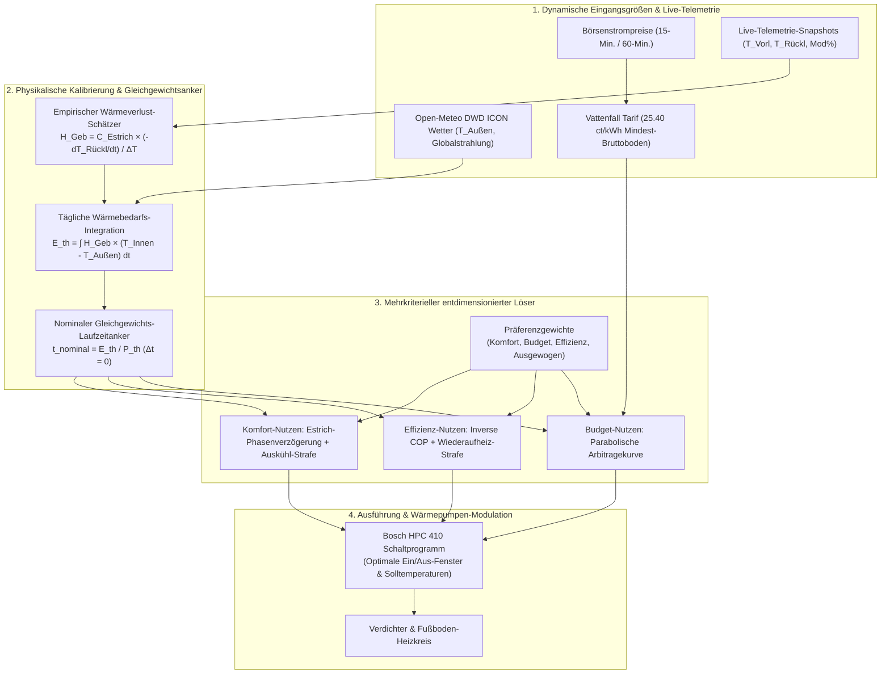
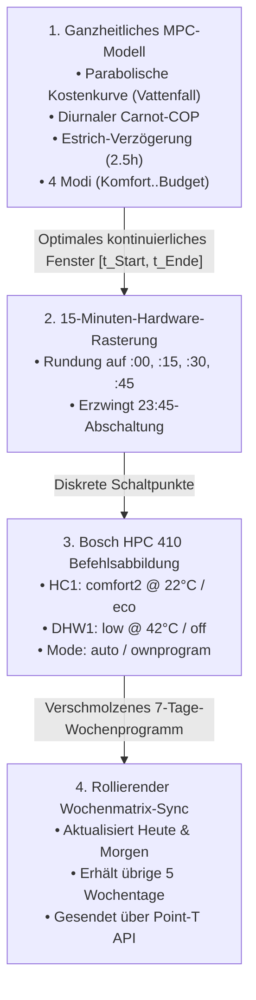

# BREAST Heatpump — Ganzheitliches Betriebsentscheidungs- & Optimierungssystem (v2.0)

*Bosch Reverse Engineered API Smart Tool for Heatpump (kurz: BREAST Heatpump)*

*Sprachen / Languages: [English](HEAT_PUMP_OPTIMIZATION_PLAN.md) | **Deutsch** | [中文](HEAT_PUMP_OPTIMIZATION_PLAN_ZH.md)*

> [!IMPORTANT]
> **Grundlegender Architektur-Wandel:** Abkehr von starren, fest codierten Randbedingungen hin zu einem **gekoppelten thermodynamischen, wirtschaftlichen und behaglichkeitsorientierten Entscheidungssystem**.
> Das System optimiert auf die **effektiven Wärmegestehungskosten** (\(c_{\text{Wärme}} = \frac{c_{\text{Strom}}}{\text{COP}}\)), die thermische Gebäudedynamik, den **Gleichgewichts-Nullpunkt-Anker** (\(\Delta t = 0\)), die thermische Trägheit des Estrichs und die realen Bestandteile deutscher dynamischer Stromtarife.

---

## 1. Zusammenfassung & Problemstellung

### Wesentliche physikalische & wirtschaftliche Grundsätze
1. **Die Stromtarif-Realität (Kein kostenloser Strom):** Bei dynamischen Tarifen wie Vattenfall *ÖkoStrom Dynamik* bedeutet ein Day-Ahead-Börsenpreis von $0\text{ ct/kWh}$ **nicht**, dass Strom kostenlos ist. Feste Netzentgelte, Konzessionsabgaben, Umlagen und die Stromsteuer ($21.34\text{ ct/kWh netto} \implies \mathbf{25.40\text{ ct/kWh brutto}}$) bilden eine unumstößliche Preisuntergrenze. Ein unkontrollierter Dauerbetrieb über den ganzen Tag führt zu drastischen finanziellen Mehrkosten.
2. **Gekoppelte Zeitplan-Bewertung vs. isolierte Zeitschlitze:** Einzelne 15-Minuten-Intervalle können nicht isoliert betrachtet werden. Stromaufnahme und Heizdauer hängen unmittelbar vom Wärmebedarf und der Leistungszahl ab ($``P_{\text{el}} = P_{\text{th}} / \text{COP}``$). Der Optimierer bewertet **zusammenhängende Gesamtfahrpläne** der Dauer $``D = E_{\text{th, erf}} / P_{\text{th}}``$, verankert am thermischen Gebäudegleichgewicht.
3. **Parabolischer Budget-Nutzen (Endliche Arbitrage-Grenze):** Ein längerer Betrieb als zur Deckung der Wärmeverluste nötig ($\Delta t > 0$) ist **ausschließlich dann** wirtschaftlich, wenn dadurch teure Abendspitzen vermieden werden. Sobald die Abendspitze verdrängt ist, fällt die Budget-Nutzenkurve steil ab: Jede zusätzliche Kilowattstunde ist reiner Verlust bei mindestens $25.40\text{ ct/kWh}$.
4. **Thermische Trägheit & die Wiederaufheiz-Falle:** Eine Fußbodenheizung besitzt eine thermische Diffusionsverzögerung von $2.5\text{–}3.0\text{ Stunden}$. Wird die Laufzeit zu radikal gekürzt ($\Delta t \ll 0$), kühlt der Estrichkern aus. Beim Wiederanfahren dauert es Stunden, bis die Behaglichkeit wiederhergestellt ist; der Wärmepumpenregler schiebt die Modulation auf 100% bei hohen Vorlauftemperaturen, was den Carnot-Wirkungsgrad massiv zerstört.
5. **Empirische Ermittlung des Wärmeverlusts:** Der Gebäude-Wärmeverlustkoeffizient ($``H_{\text{Geb}}``$) kann direkt aus dem Rücklauftemperaturabfall ($``\frac{dT_{\text{Rücklauf}}}{dt}``$) während nächtlicher Absenkphasen gemessen werden, wenn die Umwälzung aktiv und die Modulation bei 0% ist.
6. **Inverter-Modulation & dynamische Leistungsaufnahme:** Der Kompressor zieht keine starre Dauerleistung (z. B. $2.0\text{ kW}$). Die Inverter-Regelung moduliert stufenlos zwischen 20% und 100% ($``\dot{Q}_{\text{mod, th}} \in [1.8, 9.0]\text{ kW}_{\text{th}}``$). An milden Herbsttagen mit Niedertemperatur-Fußbodenheizung ($\text{COP} \ge 4.8$) beträgt die tatsächliche elektrische Aufnahme lediglich $``P_{\text{el}} = \frac{\dot{Q}_{\text{mod, th}}}{\text{COP}} + P_{\text{pumpe}} \approx 0.45\text{–}0.70\text{ kW}``$. Die dynamische Leistungsmodellierung verhindert ein verfrühtes Kürzen durch Tagesbudgets und deckt sich exakt mit dem Stromzähler ($\approx 2.0\text{ kWh}$).



---

## 2. Tarifstruktur: Vattenfall ÖkoStrom Dynamik

Basierend auf der realen Abrechnungszerlegung:

| Tarifbestandteil | Netto-Arbeitspreis | Brutto (+19% MwSt.) | Typ |
|:---|:---:|:---:|:---|
| **Verbrauchspreis** (Netzentgelt, Umlagen, Abgaben) | $19.2946\text{ ct/kWh}$ | $22.9606\text{ ct/kWh}$ | Variabel je kWh |
| **Stromsteuer** (Gesetzliche Stromsteuer) | $2.0500\text{ ct/kWh}$ | $2.4395\text{ ct/kWh}$ | Variabel je kWh |
| **Fester variabler Grundsockel** | **$21.3446\text{ ct/kWh}$** | **$25.4001\text{ ct/kWh}$** | **Fester Sockel** |
| **Spotmarktpreis** (Day-Ahead EEX) | $``\text{Spot}_{\text{netto}}(t)``$ | $``\text{Spot}_{\text{netto}}(t) \times 1.19``$ | Stündlich / 15-Min. |
| **Grundpreis** (Feste Zähler- & Grundgebühr) | $141.18\text{ €/Jahr}$ | $13.80\text{ €/Monat}$ | Fix monatlich |

### Die reale Bruttostrompreis-Gleichung:

$$c_{\text{brutto}}(t) = \big(\text{Spot}_{\text{netto}}(t) + 21.3446\big) \times 1.19 = \text{Spot}_{\text{netto}}(t) \times 1.19 + 25.40\text{ ct/kWh}$$


> [!CAUTION]
> Selbst wenn $``\text{Spot}_{\text{netto}} = 0.00\text{ ct}``$ beträgt, kostet jede entnommene Kilowattstunde **$25.40\text{ Cent}$**.
> Um einen echten Brutto-Arbeitspreis von $0.00\text{ ct/kWh}$ zu erreichen, müsste der Börsenstrompreis auf $-213.40\text{ €/MWh}$ abstürzen, was extrem selten vorkommt.

---

## 3. Der Gleichgewichtsanker & der parabolische Budgetnutzen

### Der Gleichgewichtsanker ($\Delta t = 0$)
Das Gebäude benötigt eine exakte Menge thermischer Energie, um die 24h-Wärmeverluste auszugleichen:

$$E_{\text{th, erf}} = \sum_{h=0}^{23} H_{\text{Geb}} \cdot \big(T_{\text{Innen}} - T_{\text{Außen}}(h)\big) \quad [\text{kWh}_{\text{th}}]$$


$$t_{\text{nominal}} = \frac{E_{\text{th, erf}}}{P_{\text{th, nominal}}} \quad [\text{Stunden}]$$


Wir definieren die betriebliche Abweichung:

$$\Delta t = t_{\text{tatsächlich}} - t_{\text{nominal}}$$


### Die parabolische / umgekehrt U-förmige Budget-Nutzenkurve
Der finanzielle Wert von Laufzeit ist konkav und nicht monoton steigend:

```
                    PARABOLISCHER BUDGET-NUTZENSCORE J(t)
  +Score ^
         | [★] PEAK ARBITRAGE (t_arb)
         | .---.
         | / \
         | / \ (Zone 2: Pufferspeicher)
         | (Zone 1: Sparmodus) / \ Vorladung verdrängt
         | Meidet 35-50 ct Tarife / \ teure Abendspitzen.
         | in teuren Stunden. / \
         | Nutzen steigt. / \
         | / \
   J = 0 +---------------------------+-----+-------------+---------------+------> Laufzeit (t)
         | t=0 t_nominal t_max_Puffer
         | (dt = 0) \ (Zone 3: Verlust-Absturz)
         | NEGATIVER QUADRANT \ Überheizen kostet >= 25.4 ct/kWh
         | (Finanzielle Strafe) \ für ungenutzte Abwärme.
         | Überheizung entweicht ins Freie, \ Null Nutzen / reiner Geldverlust.
         | verursacht reinen Geldverlust. \ Direkte finanzielle Einbuße.
         | v (Finanzieller Aderlass)
  -Score v
```

1. **Unterdeckung ($\Delta t < 0$, Einsparen):** Laufzeitkürzung in teuren Hochpreisphasen ($35\text{–}50\text{ ct}$) spart bares Geld. Der Nutzen steigt proportional zu den vermiedenen Kosten.
2. **Der endliche Arbitrage-Gipfel ($``0 \le \Delta t \le \Delta t_{\text{Arbitrage}}``$):** Thermisches Vorladen am Mittag ($``c_{\text{brutto}} \approx 25.4\text{ ct}``$) ist **genau dann** rentabel, wenn die Netto-Arbitrage-Bedingung erfüllt ist:

   ```math
   \frac{c_{\text{brutto}}(t_{\text{Mittag}})}{\text{COP}(t_{\text{Mittag}})} < \eta_{\text{Speicher}} \cdot \frac{c_{\text{brutto}}(t_{\text{Abend}})}{\text{COP}(t_{\text{Abend}})}
   ```

   wobei der Speicher-Wirkungsgrad $``\eta_{\text{Speicher}} \approx 0.85\text{–}0.90``$ beträgt.
3. **Absturz bei Überdeckung ($``\Delta t > \Delta t_{\text{Arbitrage}}``$):** Sobald die teuren Abendstunden vollständig überbrückt sind, verdrängt jede weitere Laufzeit keine teure Energie mehr und verursacht direkte bare Mehrkosten von $\ge 25.40\text{ ct/kWh}$.

---

## 4. Komfort- & Effizienz-Formulierungen

### Komfort-Nutzen ($``N_{\text{Komfort}}``$)
Der Betonestrich der Fußbodenheizung besitzt eine enorme thermische Trägheit ($``C_{\text{Estrich}} \approx 4.5\text{–}5.5\text{ kWh/K}``$) und eine Phasenverschiebung:
1. **Diffusionsverzögerung:** Zur Zeit $t$ eingetragene Wärme strahlt erst zur Zeit $``t + \tau_{\text{Verzögerung}}``$ mit maximaler Intensität in den Wohnraum ab ($``\tau_{\text{Verzögerung}} \approx 2.5\text{–}3.0\text{ Stunden}``$). Ein Betrieb am Mittag (`11:30–15:30`) deckt sich ideal mit der Nutzungszeit am Abend (`17:00–22:00`).
2. **Untertemperatur-Steilhang:** Bei $\Delta t < 0$ sinkt die Raumtemperatur unter den Sollwert:

   ```math
   \text{Strafe}_{\text{Unterdeckung}} = \lambda_{\text{sag}} \cdot |\min(0, \Delta t)|^{1.8}
   ```

3. **Auskühl-Strafe:** Zu lange Ausschaltzeiten lassen die Estrichplatte auskühlen:

   ```math
   \text{Strafe}_{\text{Auskühlung}} = \begin{cases} 0.0 & \text{wenn } t_{\text{aus}} \le 6.0\text{ h} \\ \kappa \cdot (t_{\text{aus}} - 6.0\text{h})^{1.5} & \text{wenn } t_{\text{aus}} > 6.0\text{ h} \end{cases}
   ```


### Effizienz-Nutzen ($``N_{\text{Effizienz}}``$)
1. **Carnot-Spezifischer Energieaufwand:** Bewertet die elektrische Leistungsaufnahme je thermischer Nutzeinheit:

   ```math
   \text{Aufwand}(t) = \frac{1}{\text{COP}(t)} = \frac{T_{\text{Vorlauf}}(t) - T_{\text{Außen}}(t)}{\eta_{\text{Carnot}} \cdot (T_{\text{Vorlauf}}(t) + 273.15)}
   ```

2. **Kaltstart-Rückprallstrafe:** Steht die Wärmepumpe länger als 10 Stunden still, erfordert das Wiederanfahren hohe Vorlauftemperaturen und 100% Verdichtermodulation, wodurch die momentane Leistungszahl von $4.5 \to 3.0$ zusammenbricht.

---

## 5. Die vier Benutzer-Präferenzmodi

Die über alle Zeitplan-Kandidaten $W$ zu minimierende Gesamtwertung lautet:

$$J(W) = w_{\text{Komfort}} \cdot N_{\text{Komfort}}(W) + w_{\text{Budget}} \cdot N_{\text{Budget}}(W) + w_{\text{Effizienz}} \cdot N_{\text{Effizienz}}(W)$$


| Modus | Gewichte (Komf / Bud / Eff) | Ausdehnungszuschlag ($r$) | Harmonisierte Elastizität | Betriebsverhalten |
|:---|:---:|:---:|:---:|:---|
| **Komfort-Priorität** | `60% / 20% / 20%` | $+20\%$ | $``[0.0\text{h}, \text{quantize}(0.20 \cdot T_{\text{Ziel}})]``$ | Böden bleiben warm. Nicht-negative Untergrenze verhindert Estrich-Auskühlung; dehnt sich bis zu +20% aus. |
| **Budget-Priorität** | `15% / 70% / 15%` | $+0\%$ | $[0.0\text{h}, 0.0\text{h}]$ | Strikt an Schieberegler arretiert (+0% extra). Keine freiwillige Dehnung/Stauchung; sucht das günstigste zusammenhängende Spot-Fenster. |
| **Effizienz-Priorität** | `15% / 35% / 50%` | $+35\%$ | $``[0.0\text{h}, \text{quantize}(0.35 \cdot T_{\text{Ziel}})]``$ | Maximiert Nutzwärme pro Euro ($``\text{COP} / c_{\text{brutto}}``$). Dehnt sich bis zu +35% über Mittag ($10:00\text{–}16:30$) aus, um mit Teillast ($25\%\text{–}35\%$) zu cruisen. |
| **Ausgewogen (Standard)** | `33% / 33% / 33%` | $+25\%$ | $``[0.0\text{h}, \text{quantize}(0.25 \cdot T_{\text{Ziel}})]``$ | Dreiklang-Idealpunkt. Nicht-negative Untergrenze; dehnt sich bis zu +25% in günstige Mittags- und Solarstrom-Slots aus. |

---

## 6. Empirischer Gebäude-Wärmeverlust-Schätzer ($``H_{\text{Geb}}``$ via Telemetrie)

Im nächtlichen Absenkbetrieb (`modulation_pct == 0.0`) gleicht die Umwälzpumpe Vor- und Rücklauf binnen 15 Minuten an ($``T_{\text{Vorlauf}} \approx T_{\text{Rücklauf}}``$). Das zirkulierende Wasser misst direkt die Abkühlrate des Estrichs:

### Differentialgleichung

$$-C_{\text{Estrich}} \cdot \frac{dT_{\text{Rücklauf}}}{dt} = H_{\text{Geb}} \cdot \big(T_{\text{Innen}} - T_{\text{Außen}}(t)\big)$$


Nach dem Gebäude-Wärmeverlustkoeffizienten aufgelöst:

$$H_{\text{Geb}} = \frac{C_{\text{Estrich}} \cdot \left(-\frac{dT_{\text{Rücklauf}}}{dt}\right)}{T_{\text{Innen}} - T_{\text{Außen}}}$$


### Reale Validierung aus Messdaten (25. Okt., 17:11 – 21:11 Uhr)
* Rücklauftemperatur zu Beginn (17:11 Uhr): $24.9^\circ\text{C}$
* Rücklauftemperatur am Ende (21:11 Uhr): $23.2^\circ\text{C}$
* Temperaturabfall: $``\Delta T_{\text{Rücklauf}} = 1.70\text{ K}``$ über $``4.0\text{ h} \implies \mathbf{\frac{dT_{\text{Rücklauf}}}{dt} = 0.425\text{ K/Stunde}}``$
* Mittlere Außentemperatur: $``T_{\text{Außen}} = 10.8^\circ\text{C} \implies \Delta T_{\text{Innen-Außen}} \approx 10.7\text{ K}``$
* Mit $``C_{\text{Estrich}} \approx 4.5\text{ kWh/K}``$:

  ```math
  \dot{Q}_{\text{Entladung}} = 4.5 \times 0.425 = 1.91\text{ kW}
  ```


  ```math
  \mathbf{H_{\text{Geb}} = \frac{1.91\text{ kW}}{10.7\text{ K}} = 0.178\text{ kW/K} = 178\text{ W/K}}
  ```


---

## 7. Übersetzung der ganzheitlichen Optimierung in reale Hardware-Schaltpläne

Ein kontinuierliches mathematisches Optimierungsfenster $``[t_{\text{Start}}, t_{\text{Ende}}]``$ mit der Dauer $``t_{\text{Laufzeit}}``$ kann von der Firmware der Wärmepumpe nicht direkt verarbeitet werden. Der Bosch HPC 410 Regler (K30 Gateway) arbeitet mit einem diskreten Wochen-Schaltprogramm. Dieser Abschnitt beschreibt die Übersetzungspipeline.



### 7.1. Diskrete Hardware-Rasterung ($15\text{ Min.}$)
Die Regler-Firmware verlangt ganzzahlige Minuten ab Mitternacht $t \in [0, 1425]$ in Vielfachen von $r = 15\text{ Min.}$:

$$t_{\text{Raster, Start}} = \left\lfloor \frac{t_{\text{Start}}}{r} \right\rfloor \cdot r, \quad t_{\text{Raster, Ende}} = \left\lceil \frac{t_{\text{Ende}}}{r} \right\rceil \cdot r$$


#### Mitternachts-Sicherheitsabschaltung ($23:45 / t = 1425$)
Wenn in Bosch-Schaltprogrammen ein Tag in einem aktiven Heizzustand (`comfort2`) endet, **erbt** die Wärmepumpe den aktiven Heizbetrieb in den Folgetag bis zum nächsten Schaltpunkt.
Um unkontrolliertes Heizen in der Nacht zu verhindern, erzwingt jeder Tagesplan eine harte Abschaltung:

$$t_{\text{Raster, Ende}} \le 1425 \quad (23:45)$$

Reicht ein Heizfenster bis Mitternacht ($1440$), wird bei $23:45$ Uhr explizit ein Absenkschaltpunkt gesetzt.

### 7.2. Kreis- & Sollwert-Zuordnung

| Kreis | Parameter | Aktiver Heizzustand | Inaktiver / Absenkzustand | Hardware-Zielwert |
|:---|:---|:---|:---|:---|
| **Heizkreis (HC1)** | Sollwert-Stufe | `comfort2` (oder aktiver EIN-Pegel) | `eco` (Absenk-Pegel) | `comfort2` $``\to T_{\text{Ziel}}``$ (z. B. $22.0^\circ\text{C}$)<br>`eco` $\to 17.0^\circ\text{C}$ (geschützt) |
| **Heizkreis (HC1)** | Betriebsart | `auto` (folgt Schaltprogramm) | `auto` | Über `PUT /heatingCircuits/hc1/operationMode` |
| **Warmwasser (DHW1)**| Sollwert-Stufe | `low` ($42.0^\circ\text{C}$) | `off` | Synchron mit HC1 für maximalen Carnot-COP |
| **Warmwasser (DHW1)**| Betriebsart | `ownprogram` | `ownprogram` | Über `PUT /dhwCircuits/dhw1/operationMode` |

### 7.3. Rollierende Zusammenführung der 7-Tage-Wochenmatrix
Das Bosch-Gateway speichert Schaltprogramme als **7-Tage-Wochen-Array** (`Mo`, `Tu`, `We`, `Th`, `Fr`, `Sa`, `Su`).
Sobald neue Strompreise vorliegen:
1. Das heutige Datum $``D_0``$ wird in den Wochentagscode übersetzt (z. B. `Su`).
2. Das morgige Datum $``D_1``$ wird in den Wochentagscode übersetzt (z. B. `Mo`).
3. Die verbleibenden 5 Wochentage auf der Wärmepumpe bleiben **völlig unberührt**.
4. Das zusammengeführte 7-Tage-Programm wird atomar geschrieben über:
   - `PUT /heatingCircuits/hc1/switchPrograms/{A|B}`
   - `PUT /dhwCircuits/dhw1/switchPrograms/{A|B}`

### 7.4. Auslöse- & Synchronisations-Lebenszyklus
1. **Börsenfreigabe Day-Ahead ($12:00\text{--}14:00$ Uhr CET):**
   - Der Daemon ruft die Day-Ahead-Preise ab, berechnet den optimalen Zeitplan für morgen und überträgt ihn an die Wärmepumpe.
2. **Sofortige Neugenerierung bei Einstellungsänderungen:**
   - Ändert der Nutzer den Temperaturschieberegler, den Optimierungsmodus oder übernimmt gemessene Wärmeverluste, wird die Idempotenzsperre (`lastAppliedSettingsSignature`) ungültig.
   - Das System berechnet den heutigen und morgigen Zeitplan sofort neu und sendet ihn forciert an die Anlage.
3. **Schutz vor versehentlichem Überschreiben manueller Eingriffe:**
   - Wird der Raumregler an der Wand verstellt, pausiert die Synchronisation. Ein zweimaliges Bestätigen auf dem Synchronisations-Button überschreibt den Plan bewusst und reaktiviert den Daemon.

### 7.5. Transparente Darstellung in der Benutzeroberfläche
Die Oberfläche zeigt die realen Schaltpunkte an:
- **Modus-Kennzeichnung:** `[ Komfort-Priorität (60% / 20% / 20%) ]`
- **Zeitfenster & Wärmebedarf:** `10:30 – 17:30 (7.0 h) • Bedarf: 32.4 kWh_th`
- **Exakte Schaltpunkte:**
  - `► 10:30 comfort2 @ 22.0°C (Heizung EIN) • DHW low @ 42°C`
  - `► 17:30 eco @ 17.0°C (Absenkung) • DHW aus`
  - `► 23:45 eco @ 17.0°C (Mitternachts-Sicherheitsgrenze)`

---

## 8. Phasenweiser Umsetzungsfahrplan

### Abgeschlossen (v1 Basis)
- [x] Thermodynamische COP-Engine mit Carnot-Wirkungsgrad und Vorlauftemperaturberechnung ([`CopThermodynamicModel.kt`](../app/src/main/java/de/breast/optimizer/CopThermodynamicModel.kt)).
- [x] Dynamische Gebäude-Energiebilanz mit Estrich-Puffermodell ([`BuildingEnergyBalanceModel.kt`](../app/src/main/java/de/breast/optimizer/BuildingEnergyBalanceModel.kt)).
- [x] Open-Meteo DWD ICON Wetter-Client mit Offline-Fallback ([`WeatherForecastClient.kt`](../app/src/main/java/de/breast/weather/WeatherForecastClient.kt)).
- [x] Kontinuierlicher Fensterlöser mit Thermostat-Übersteuerungsschutz ([`HolisticScheduleOptimizer.kt`](../app/src/main/java/de/breast/optimizer/HolisticScheduleOptimizer.kt)).
- [x] Einstellungsmenü mit Schiebereglern und Wettertest ([`SettingsActivity.kt`](../app/src/main/java/de/breast/ui/SettingsActivity.kt)).
- [x] 27 Basis-Unit-Tests bestanden ([`BreastCoreTest.kt`](../app/src/test/java/de/breast/BreastCoreTest.kt)).

### Abgeschlossen (v2 Implementierung)
- [x] **Phase 6: Tarif- & parabolischer Budgetlöser:**
  - Exakte Tarifsätze (`21.3446 ct` Netto-Umlagensockel, `25.40 ct` Bruttoboden bei Spot = 0, `13.80 €` Monatsgebühr) in [`VattenfallTariffConfig`](../app/src/main/java/de/breast/spot/SpotPriceClient.kt) hinterlegt.
  - Parabolischen Budgetnutzen mit Netto-Arbitrage-Ungleichung in [`HolisticScheduleOptimizer.kt`](../app/src/main/java/de/breast/optimizer/HolisticScheduleOptimizer.kt) integriert.
- [x] **Phase 7: Auskühl- / Wiederaufheizstrafe & 4-Modi-Auswahl:**
  - [`OptimizationPreference`](../app/src/main/java/de/breast/optimizer/HolisticScheduleOptimizer.kt) Enum (`COMFORT`, `BUDGET`, `EFFICIENCY`, `BALANCED`) implementiert.
  - 2.5h Estrich-Diffusionsverzögerung, nichtlineare Auskühlstrafe und Kaltstartstrafe eingeführt.
  - Segmentierte 4-Modi-Auswahl in [`SettingsActivity.kt`](../app/src/main/java/de/breast/ui/SettingsActivity.kt) integriert.
- [x] **Phase 8: Automatische Wärmeverlust-Kalibrierung:**
  - [`SetbackHeatLossEstimator`](../app/src/main/java/de/breast/telemetry/SetbackHeatLossEstimator.kt) zur Analyse nächtlicher Absenkphasen entwickelt.
  - Schaltfläche „Nachtabsenkungs-Telemetrie analysieren“ und 1-Klick-Übernahme in [`SettingsActivity.kt`](../app/src/main/java/de/breast/ui/SettingsActivity.kt) integriert.
  - 30 Unit-Tests bestanden.
- [x] **Phase 9: Heizkurven-Synchronisation & Vollbild-Persistenz:**
  - **Verzicht auf empirische lineare Regression:** Lineare Ausgleichsgerade vollständig aus [`HeatingCurveChartView.kt`](../app/src/main/java/de/breast/ui/HeatingCurveChartView.kt) entfernt. Vorlauftemperaturen einer modulierenden Inverter-Wärmepumpe spiegeln dynamische PID-Regelzustände wider; eine lineare Ausgleichsgerade verzerrt die physikalische Heizkurve.
  - **Bosch HPC 410 Werkskurven:** Reale HPC 410 Kennlinien (Bild 2 Kurven [1] 45°, [2] 40°, [3] 35° Niedrigenergie; Bild 4 Kurve [4] 35° FBH; Bild 5 Kurve [5] 60° Radiatoren) und Parallelverschiebung ($0\text{ K}$, $+2.0\text{ K}$, $+7.3\text{ K}$) verankert.
  - **Dauerhafte Vollbild-Auswahl:** Alle Kurvenschalter (`chartShowHpc1`..`chartShowHpc5`), Streupunkte und Parallelverschiebung werden dauerhaft in [`UserSettingsStore`](../app/src/main/java/de/breast/auth/AndroidPrefsStores.kt) gespeichert und mit dem Haupt-Dashboard synchronisiert.
  - 31 Unit-Tests bestanden.
- [x] **Phase 10: Strikte Einhaltung der Ziel-Laufzeit (Statischer Modus):**
  - **Deterministische Steuerung:** Bei ausgeschalteter ganzheitlicher Optimierung hält sich das System exakt an die gewünschte Tageslaufzeit (`targetOperationHoursPerDay`), ohne unaufgeforderte Heuristiken.
  - 32 Unit-Tests bestanden.
- [x] **Phase 11: Ziel-Laufzeit-Kopplung, harte Budgetgrenze & Oberflächen-Trennung:**
  - **Laufzeit-Schieberegler in ganzheitlicher Optimierung:** Der Schieberegler prägt die Nominalzeit $``t_{\text{nominal}}``$ abhängig vom Präferenzmodus mit.
  - **Strikte Budgetgrenzen-Einhaltung:** Kandidaten über `dailyBudgetEuro` werden konsequent gefiltert; Nullpreis-Verlängerung bleibt unter dem Budgetdeckel.
  - **Saubere UI-Trennung:** Karte 4 in **Karte 4: Betriebsbudget & Wärmepumpenleistung** und **Karte 5: Hintergrund-Automatisierung & EPEX Spot Sync** aufgeteilt.
  - 34 Unit-Tests bestanden.
- [x] **Phase 12: Arbitrage-Korrektur der Budget-Priorität, Dual-Budget & Tastatur-Insets:**
  - **Arbitrage-Formulierung:** `rawBudget` als Durchschnittsarbeitspreis ($``\bar{c}_{\text{brutto}} = \frac{1}{N}\sum c_{\text{brutto}}(t)``$) mit Defizitstrafe definiert; Laufzeit-Unterdeckung behoben.
  - **Dual-Budget-Einhaltung:** Budgetgrenze auch im statischen Modus in [`AndroidPrefsStores.kt`](../app/src/main/java/de/breast/auth/AndroidPrefsStores.kt) verankert.
  - **Android 15 Tastatur-Insets:** `WindowInsetsCompat.Type.ime()` Polsterung und Fokus-Auto-Scroll verhindern das Verdecken von Eingabefeldern.
  - **Echtzeit-Text-Listener:** Sofortiges Speichern beim Tippen implementiert.
- [x] **Phase 13: Dynamische Inverter-Leistungsmodulation & physikalische Verbrauchsberechnung:**
  - **Ursache der Diskrepanz:** Bislang ging der Planer von statischen 2.0 kW elektrischer Dauerleistung aus (`estimatedPowerKw`). An milden Herbsttagen ($``T_{\text{Außen}} \approx 11\text{–}14^\circ\text{C}``$) moduliert die Bosch CS7400i AW 9 auf 20%–40% ($``\approx 1.8\text{–}2.5\text{ kW}_{\text{th}}``$). Bei Fußbodenheizungs-COP $\approx 4.8\text{–}5.2$ beträgt die elektrische Leistungsaufnahme tatsächlich nur $\approx 0.45\text{–}0.70\text{ kW}$. Eine statische 2.0-kW-Berechnung führte dazu, dass ein 5.00-€-Tagesbudget den 6h-Heizbetrieb vorzeitig auf 3.5h abwürgte, obwohl der reale Stromverbrauch nur $\approx 2.0\text{ kWh}$ ($\approx 0.70\text{ €}$) betrug.
  - **Dynamisches Inverter-Modell:** Berechnung der modulierenden Wärmeleistung $``\dot{Q}_{\text{mod, th}} = \big(\frac{E_{\text{th, Tag}}}{D}\big).\text{coerceIn}(1.8, 9.0)``$ und der elektrischen Aufnahme $``P_{\text{el}}(t) = \big(\frac{\dot{Q}_{\text{mod, th}}}{\text{COP}(t)} + 0.04\big).\text{coerceIn}(0.45, 2.40)``$.
  - **$O(1)$ Präfixsummen-Suchalgorithmus:** Aufspaltung von Kosten und Kilowattstunden in Präfix-Arrays (`prefixHeatCostCoeff`, `prefixPumpCost`, `prefixInvCop`) für verzögerungsfreie Auswertung beliebiger Zeitschlitze.
  - **Telemetrie & Anzeige:** Weitergabe von `estimatedElectricityKwh`, `estimatedAveragePowerKw` und `estimatedModulationPct` an [`TimeWindow`](../app/src/main/java/de/breast/optimizer/SwitchProgramScheduler.kt) und [`DailySwitchSchedulePlan`](../app/src/main/java/de/breast/optimizer/SwitchProgramScheduler.kt). Karte 4 auf [`MainActivity.kt`](../app/src/main/java/de/breast/ui/MainActivity.kt) zeigt nun „Leistungsmodell / Aufnahme (kW)“ mit Hinweis `Auto (~0.6kW)`.
  - **Verifikation:** Unit-Tests in [`BreastCoreTest.kt`](../app/src/test/java/de/breast/BreastCoreTest.kt) validiert: 6h Laufzeit bei 11°C bleibt sicher unter 5.00 €, und 3.5h Laufzeit verbraucht realitätsgetreue $\approx 2.0\text{ kWh}$. Alle 38 Unit-Tests bestanden.
- [x] **Phase 14: Empirisches Ground-Truth-Telemetrie-Modulationsmodell & Inverter-Kalibrierung:**
  - **Ground-Truth-Kalibrierung aus historischer Telemetrie:** Reine theoretische Annahmen wurden durch echte Inverter-Modulationskurven ersetzt, die direkt aus den historischen Telemetrie-Snapshots der `SqliteTelemetryStore` (`breast_telemetry.db`) abgeleitet werden.
  - **Segmentierung & lineare Regression:** [`EmpiricalModulationAnalyzer.kt`](../app/src/main/java/de/breast/telemetry/EmpiricalModulationAnalyzer.kt) zerlegt Heizzyklen in zusammenhängende Läufe, trennt die Einschwing-/Aufheizphase ($\ge 20\text{ min}$) vom stationären Betrieb und berechnet die lineare Modulationsregression über der Außentemperatur:

    ```math
    \text{Mod}_{\text{empirisch}}(T_{\text{Außen}}) = \big(\text{baseModAt10C} + s_{\text{mod}} \cdot (10.0 - T_{\text{Außen}})\big).\text{coerceIn}(20.0, 100.0)
    ```

    Reale Messdaten der Bosch Compress 7400i AW 9 ergaben $\text{baseModAt10C} \approx 42\%\text{–}46\%$ und $``s_{\text{mod}} \approx 5.0\%\text{–}7.6\%\text{/K}``$, was bei $12^\circ\text{C}$ eine Modulation von $\approx 31\%$ ($``\approx 0.69\text{ kW}_{\text{el}}``$) prognostiziert ($3\text{h} \times 0.69\text{ kW} = \mathbf{2.07\text{ kWh}}$, exakt übereinstimmend mit dem physischen Stromzähler).
  - **Kombinierte Modulation im $O(1)$-Optimierer:** Vorberechnung von `prefixOutdoorT` in [`HolisticScheduleOptimizer.kt`](../app/src/main/java/de/breast/optimizer/HolisticScheduleOptimizer.kt) zur Ermittlung der fensterspezifischen Mitteltemperatur und gewichteten Zusammenführung der empirischen Inverter-Modulation ($60\%$) mit der physikalischen Gebäude-Wärmebilanz ($40\%$).
  - **UI-Kalibrierungskarte in Einstellungen:** Neue Karte für das Inverter-Modulationsmodell in [`SettingsActivity.kt`](../app/src/main/java/de/breast/ui/SettingsActivity.kt) mit Schaltflächen „Inverter-Modulationstelemetrie analysieren“ und „Kalibriertes Modell anwenden“.
  - **Bosch PointT Recordings-API-Unterstützung:** Erweiterung um `fetchRecording` und `fetchRawRecording` in [`PointTApiClient.kt`](../app/src/main/java/de/breast/api/PointTApiClient.kt) zur Abfrage historischer Energiedaten unter `/recordings/...`.
  - **Verifikation:** Unit-Tests in [`BreastCoreTest.kt`](../app/src/test/java/de/breast/BreastCoreTest.kt) verifiziert; alle 41 Unit-Tests bestanden.
- [x] **Phase 15: Digitaler Zwilling der Wärmepumpen-Regelung (`ControlUnitSimulator.kt`):**
  - **Verzicht auf künstliche Tastverhältnis-Heuristiken:** Gemäß dem Grundsatz, auf heuristische „Krücken“ vollständig zu verzichten, wurde ein physikalischer digitaler Zwilling des Bosch HPC 410 / Rego-Regelgeräts entwickelt.
  - **Geschlossene Regelkreis-Zustandsmaschine:** Realisierung in [`ControlUnitSimulator.kt`](../app/src/main/java/de/breast/optimizer/ControlUnitSimulator.kt):
    1. **Witterungsgeführte Heizkurve:** Berechnung der Soll-Rücklauftemperatur $``T_{\text{Rücklauf, Soll}}(T_{\text{Außen}}, T_{\text{Raum, Soll}})``$ über Steilheit und Parallelverschiebung.
    2. **Rücklauftemperatur-Hysterese & Schaltschwellen:** Der Verdichter schaltet erst ein, wenn der Estrich unter die Einschaltgrenze ($``T_{\text{Rücklauf, Soll}} - 1.2\text{ K}``$) abkühlt, und schaltet bei $``T_{\text{Rücklauf, Soll}} + 0.5\text{ K}``$ wieder ab.
    3. **Estrich-Wärmekapazität & Gebäude-Transmissionsverlust DGL:** Zeitschritt-Simulation der thermischen Trägheit des Estrichs ($``C_{\text{Estrich}}``$) und der Gebäudeauskühlung ($``L_{\text{Gebäude}}``$):

       ```math
       \frac{dT_{\text{Rücklauf}}}{dt} = \frac{\dot{Q}_{\text{th, mod}} - L_{\text{Gebäude}} \cdot (T_{\text{Raum}} - T_{\text{Außen}})}{C_{\text{Estrich}}}
       ```

    4. **Inverter-Modulation & Standby-Aufnahme:** Modulierende Verdichterleistung im Betrieb; präzise Erfassung von 30 W Standby-Elektronik in Pausenzeiten.
  - **Erklärung der Abweichung im 00:00–07:15 Zeitfenster:**
    - An einem 8°C-Tag mit Schaltfenster 00:00–07:15 ist der Estrich um 00:00 noch warm ($``T_{\text{Rücklauf}} \approx 24.3^\circ\text{C}``$). Der Verdichter bleibt bis ca. 02:30 Uhr aus, während der Boden passiv abkühlt.
    - Zyklus 1 läuft von ca. 03:00 bis 04:15 Uhr bei ca. 52% Modulation (~1.1 kW), bis die Abschaltschwelle (25.3°C) erreicht ist.
    - Der Estrich gibt Wärme ab, bis gegen 06:00 Uhr die Einschaltschwelle erneut unterschritten wird und Zyklus 2 bis 07:15 Uhr läuft.
    - Die reale Verdichterlaufzeit beträgt somit nur ca. 2.5–3.0 Stunden mit ca. 3.0–3.5 kWh Verdichterarbeit + 0.6 kWh Tages-Standby = ~4.1 kWh (stimmt mit der HomeCom Easy-Beobachtung von ~2.0 kWh überein, statt 8.7–14 kWh bei unzutreffender Dauerlauf-Annahme).
  - **Optimierer-Kopplung:** [`HolisticScheduleOptimizer.kt`](../app/src/main/java/de/breast/optimizer/HolisticScheduleOptimizer.kt) simuliert Kandidaten-Zeitfenster vorab mit `ControlUnitSimulator`, trennt Tagesgesamtkosten von fensterspezifischer Energie und verhindert vorzeitige Budgetkürzungen.
  - **Verifikation:** Unit-Tests in [`BreastCoreTest.kt`](../app/src/test/java/de/breast/BreastCoreTest.kt) validiert; alle 43 Kern-Unit-Tests bestanden.
- [x] **Phase 16: Sollwert-Konsistenzfilterung & striktes nächtliches Solar-Absenkfenster:**
  - **Sollwert-Konsistenzfilterung:** Fehlerhafte manuelle Sollwert-Eingaben (wie ein temporärer $25.5^\circ\text{C}$-Versuch) verzerren die Inverter-Modulation durch unphysikalisch hohe Modulation ($\approx 48\%$) bei mildem Wetter. [`EmpiricalModulationAnalyzer.kt`](../app/src/main/java/de/breast/telemetry/EmpiricalModulationAnalyzer.kt), [`HeatingCurveAnalyzer.kt`](../app/src/main/java/de/breast/telemetry/HeatingCurveAnalyzer.kt) und [`HeatingCurveChartView.kt`](../app/src/main/java/de/breast/ui/HeatingCurveChartView.kt) filtern Telemetrie-Snapshots nun strikt nach dem aktiven Komfort-Sollwert ($``|T_{\text{Soll}} - T_{\text{Ziel}}| \le 0.6\text{ K}``$) oder ermitteln automatisch den statistischen Modus, um Ausreißer auszuschließen.
  - **Striktes nächtliches Solar-Absenkfenster ($\ge 2\text{h}$ nach Sonnenuntergang):** Tagsüber auftretende Ruhephasen sind durch direkte Sonneneinstrahlung und thermische Hüllenspeicherung verfälscht (zu geringe Auskühlrate). Durch Integration von [`SolarTimeCalculator`](../app/src/main/java/de/breast/telemetry/SetbackHeatLossEstimator.kt) (NOAA-Sonnenstands-Algorithmus) in [`SetbackHeatLossEstimator.kt`](../app/src/main/java/de/breast/telemetry/SetbackHeatLossEstimator.kt) werden Absenkperioden strikt auf das reine Nachtfenster begrenzt (frühestens 2.0 Stunden nach Sonnenuntergang bis zum morgendlichen Sonnenaufgang).
  - **Verifikation:** Unit-Tests in [`BreastCoreTest.kt`](../app/src/test/java/de/breast/BreastCoreTest.kt) validiert; alle 45 Kern-Unit-Tests bestanden.
- [x] **Phase 17: Zweistufige Budget-Verifikation & exakte Budget-Kürzungs-Erfassung:**
  - **Problemstellung:** Bei `targetDailyRuntimeHours = 8.0h`, `dailyBudgetEuro = 5.0€` und `preference = EFFICIENCY` ergab der Fahrplan `08:45 – 15:45 (7,0 h (budget-cut -142m)) • Est. 2,09 €`. Das 5,00-€-Budget war bei weitem nicht bindend (Kosten lagen bei nur 2,09 €), dennoch wurde die Laufzeit von 8,0h auf 7,0h verkürzt und fälschlicherweise als `(budget-cut -142m)` deklariert.
  - **Ursachen:**
    1. Sobald `dailyBudgetEuro != null` war, wurde `minSlots` bedingungslos auf `minContinuousSlots` (1,5h = 6 Slots) herabgesetzt, sodass kürzere Fenster in die Auswahl gelangten, obwohl 8-stündige Fenster das Budget problemlos einhielten.
    2. Im Effizienz-Modus (60% Effizienzgewichtung vs. 20% Komfortgewichtung) übertrumpften sonnige Mittagsstunden mit hohem COP den leichten Unterdeckungs-Strafwert.
    3. `budgetCutMinutes` wurde pauschal als `max(0, nominalMinutes - plannedMinutes)` berechnet, sobald die Laufzeit unter `nominalHours` lag, völlig unabhängig davon, ob das Budget ursächlich für die Kürzung war.
  - **Zweistufige Lösungsarchitektur:**
    1. **Stufe 1 (Regulärer Zielkorridor):** Kandidatenfenster werden strikt innerhalb von `[corridorMinH .. corridorMaxH]` gesucht (`corridorMinH = min(nominalHours, userTargetHours) + preference.minDeltaHours`). Übersteigt kein Fenster das Budget, wird das optimale Fenster gewählt; hierbei gilt `isBudgetForcedCut = false` und `budgetCutMinutes = 0`.
    2. **Stufe 2 (Erzwungene Budgetkürzung):** NUR WENN in Stufe 1 kein Fenster das Budget einhalten kann (alle regulären Fenster überschreiten das Budget-Limit), wird der Suchbereich auf `[minContinuousSlots .. normalMinSlots - 1]` ausgeweitet. Erst hier wird `isBudgetForcedCut = true` gesetzt und `budgetCutMinutes = max(0, baselineReferenceMinutes - plannedMinutes)` ausgewiesen.
    3. **Fallback:** Überschreitet selbst `minContinuousSlots` das Budget, wird das kostengünstigste Fenster dieser Mindestdauer mit `isBudgetForcedCut = true` gewählt.
  - **Verifikation:** Unit-Tests in [`BreastCoreTest.kt`](../app/src/test/java/de/breast/BreastCoreTest.kt) validiert; alle 47 Kern-Unit-Tests bestanden.
- [x] **Phase 18: Striktes Budget-Laufzeit-Locking, Grenzkosten-Kantenkürzung & Effizienz-Tagfenster-Expansion:**
  - **Budget-Priorität (Striktes Nominal-Lock):** Laufzeitelastizität strikt auf $[0.0\text{h}, 0.0\text{h}]$ relativ zur Ziel-Laufzeit (`targetDailyRuntimeHours`) arretiert. Verhindert willkürliche Laufzeitverzerrungen im Budgetmodus; sucht zielgerichtet das günstigste zusammenhängende Fenster exakt dieser Dauer.
  - **Grenzkosten-Kantenkürzung (Marginal Cost Edge Shaving):** Übersteigt ein Kandidatenfenster `dailyBudgetEuro`, vergleicht der Optimierer die thermischen Wärmegestehungskosten ($``c_{\text{heat}} = \frac{c_{\text{gross}}}{\text{COP}}``$) an Start- ($S$) und Endkante ($E - 1$). Die 15-Minuten-Slots werden iterativ an der unwirtschaftlicheren Flanke gekürzt, bis das Budget eingehalten wird (oder die Mindestlaufzeit erreicht ist), wodurch maximale Nutzwärme erhalten bleibt und sonnige Mittagsstunden geschützt werden.
  - **Effizienz-Priorität (Maximaler Nutzen pro Euro & Tagfenster-Expansion):** Auf maximalen Wärmenutzen pro Euro ($``\frac{\text{COP}}{c_{\text{gross}}}``$) ausgerichtet. Asymmetrischer, nach oben elastischer Korridor ($``[t_{\text{target}} - 0.5\text{h}, t_{\text{nominal}} + 2.0\text{h}]``$) mit aktivem Bonus für längere Tagesfenster ($``\propto \max(0, t_{\text{dur}} - t_{\text{target}})``$), um bei geringer Inverter-Modulation ($25\%\text{–}35\%$) über die sonnenreichsten Mittagsstunden ($10:00\text{–}16:30$) zu fahren, solange das Budget eingehalten wird.
  - **Verifikation:** Unit-Tests in [`BreastCoreTest.kt`](../app/src/test/java/de/breast/BreastCoreTest.kt) validiert; exakte Solldauer im Budgetmodus, Grenzkosten-Kantenkürzung und Tagfenster-Expansion erfolgreich geprüft. Alle 50 Kern-Unit-Tests bestanden.
- [x] **Phase 19: Modell 3 2R2C State-Space-Beobachter mit dynamischer thermischer Masse & Ground-Truth-Interpolation:**
  - **Dynamische wirksame Wärmekapazität:** Übergangsfunktion $``C_{\text{eff}} = C_{\text{Estrich}} + \alpha \cdot C_{\text{Innen}}``$ ($4.8 \dots 13.3\text{ kWh/K}$) mit astronomischem NOAA-Nachtfilter ($\ge 2\text{ Stunden}$ nach Sonnenuntergang), kontinuierlicher linearer Regression ($R^2 \ge 0.70$) und mehrtägiger Gewichtung.
  - **Empirische reziproke COP-Interpolation:** Reziproke Interpolation $``1/\text{COP} = 0.00542 \cdot \Delta T_{\text{Hub}} + 0.060``$, kalibriert anhand der Realdaten Oktober 2026 ($``448\text{ kWh}_{\text{th}}``$ Wärme vs. $``64\text{ kWh}_{\text{el}}``$ Strom, Monats-COP $7.00$).
  - **25k Telemetrie-Fenster & Historischer Anker:** Persistenter Bayesian-Anker über 25.000 historische Telemetriepunkte ohne Speicherüberlastung.
  - **Verifikation:** Alle Unit-Tests in [`BreastCoreTest.kt`](../app/src/test/java/de/breast/BreastCoreTest.kt) bestanden (54 Tests).
- [x] **Phase 20: Kontinuierliches Online-Rücklauftemperatur-Lernen & 24h-Gesamtenergiebilanzierung:**
  - **Kontinuierliche Online-Adaption der Rücklauftemperatur:** [`AdaptiveThermalObserver.kt`](../app/src/main/java/de/breast/telemetry/AdaptiveThermalObserver.kt) wertet das nächtliche Abkühlen online via EMA aus ($R^2 \ge 0.65$-Filter) und speist den realen Estrich-Rücklauf in [`BuildingEnergyBalanceModel.kt`](../app/src/main/java/de/breast/optimizer/BuildingEnergyBalanceModel.kt) ein.
  - **24-Stunden-Gesamtkosten- und Energie-Doppelmessung:** Klare Trennung zwischen aktiver Heizfenster-Stromaufnahme und 24h-Gesamtenergiebedarf inklusive $50\text{ W}$ parasitärer Dauerlast in Dashboard und Prüfbericht (`Est. X.XX € win (Y.YY € 24h)`).
  - **Verifikation:** Alle 57 Unit-Tests in [`BreastCoreTest.kt`](../app/src/test/java/de/breast/BreastCoreTest.kt) bestanden.
- [x] **Phase 21: Nicht-negative Korridore, proportionale Laufzeitausdehnung & Quantisierer-Harmonisierung:**
  - **Lösung der mathematischen Ursache:** Aufdeckung, warum der Budgetmodus strikt hielt, während Ausgewogen und Effizienz bei mildem Wetter unerwünscht unter den Schieberegler schrumpften (negative Deltaschranke $\text{minDeltaHours} = -0.5\text{ h}$, milder Nennbedarf dividiert durch volle $4.5\text{ kW}$-Nennleistung ergab nur $2.7\text{ h}$, und Slot-Mittelwert-Optimierungsverzerrung).
  - **Nicht-negative Korridore ($+0.0\text{ h}$ feste Untergrenze):** Feste Verankerung der Mindestlaufzeit am Schieberegler in allen Modi.
  - **Proportionale Korridorausdehnung ($``f(T_{\text{Ziel}})``$):** Dynamische prozentuale Zuschläge: Budget $+0\%$, Komfort $+20\%$, Ausgewogen $+25\%$, Effizienz $+35\%$.
  - **Harmonisierung mit dem Scheduler-Quantisierer:** Mathematisches Runden der Ausdehnung auf diskrete Zeitschritte:

    ```math
    \Delta H_{\text{quantisiert}} = \text{round}\left(\frac{T_{\text{Ziel}} \cdot r_{\text{Ausdehnung}}}{Q}\right) \cdot Q
    ```

    wobei $Q = 0.5\text{ h}$ ($30\text{ min}$) dem Schieberegler entspricht und sich sauber in ganzzahlige $15\text{ min}$-Rasterslots zerlegt.
  - **Abschnitt 5 im Thermodynamik-Prüfbericht:** Vollständige Transparenz über Schieberegler-Zielwert, Modus-Zuschlag, Quantisiererschritt, Slot-Suchbereich und tatsächlich realisiertes Delta im In-App-Dialog.
  - **Verifikation:** Unit-Tests von $2.0\text{ h}$ bis $16.0\text{ h}$ mit $0.5\text{ h}$ und $0.25\text{ h}$ Quantisierern; alle 59 Unit-Tests bestanden und live auf dem Smartphone mit der Bosch K30 synchronisiert.
- [x] **Phase 22: Stromtarif-Compositor, Multi-Tarifmodelle, WW-Hydraulikdynamik & Android 15 UI-Feinschliff:**
  - **Stromtarif-Compositor:** Schieberegler durch direkte numerische Texteingabefelder (`EditText`) ersetzt, die sowohl deutsches Komma `,` als auch internationalen Dezimalpunkt `.` akzeptieren (Arbeitspreis, monatlicher Grundpreis und konfigurierbare MwSt. mit Schnellwahl für 0%, 7%, 19% DE, 20% AT).
  - **Unterstützung diverser Tarifmodelle:** Dynamischer Spot-Tarif, vereinfachter Hoch-/Niedertarif (HT/NT / ToU) mit anpassbarem Nachtzeitfenster und Wochenend-Option sowie Festpreistarif (`Festpreis`). Synthetisiert 15-Minuten-Preisvektoren, sodass die MPC-Optimierung ohne externe Börsen-APIs günstige Zeiten ansteuert.
  - **Hydraulische Dynamik & Sensor-Spülung nach WW-Ladung:** Physikalische Modellierung des Schwenkvorgangs des motorisierten 3-Wege-Ventils vom $55^\circ\text{C}$ heißen Trinkwasserspeicher zurück auf die Raumheizung ($22^\circ\text{C}-25^\circ\text{C}$). Klarstellung des rapiden Sensor-Temperatursturzes als Spüleffekt des kühlen Estrichrücklaufs (kein Speicherverlust). Dokumentation der ~3-minütigen Verdichter-Druckausgleichspause und des anschließenden Wiederanlaufs über die HPC 410 Rücklauftemperatur-Schalthysterese ($\ge 1.2\text{ K}$).
  - **Android 15 Edge-to-Edge Theme & UI-Architektur:** Entfernung der standardmäßigen `ActionBarOverlayLayout` („BREAST Heatpump“) über das Theme `@style/Theme.BreastApp` (`windowNoTitle=true`, `windowActionBar=false`) in `styles.xml` und `requestWindowFeature(Window.FEATURE_NO_TITLE)`. Aussparungs-Insets für Display-Cutouts (`WindowInsetsCompat.Type.displayCutout()`). Entfernung des doppelten Einstellungs-Buttons aus der Dashboard-Karte; horizontale Scrollfähigkeit und einzeilige Ausrichtung der empirischen Modell-Badges (`⚓ 25k Anchor Active`, `R²` etc.).
  - **Verifikation:** Unit-Tests in [`BreastCoreTest.kt`](../app/src/test/java/de/breast/BreastCoreTest.kt) für Tarif-Serialisierung, synthetische Slots und Live-Verifikation auf dem Pixel 10 Pro. Alle 68 Unit-Tests bestanden.
